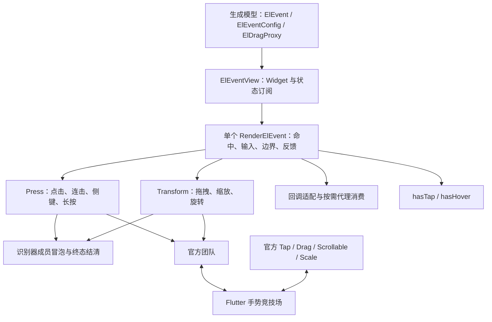

# ElEventView 独立手势接入与 Render 精简记录

状态：代码实施与自动化验收完成；真实设备输入和性能尚未实测。

## 目标与边界

- 删除 ElEventDispatcher，Render 直接连接独立识别器，不保留旧的全局输入路线、胜出者和驱动者模型。
- 识别器负责手势识别、成员冒泡、停止传播和官方竞技场协作；Render 只处理元素相关行为。
- ElEventConfig 仅保存可空声明，默认识别参数由识别器管理；边界策略与反馈时间由 Render 管理。
- 识别器构造器保留官方通用选项，识别参数通过属性修改；可空参数设为 null 恢复默认行为，当前轮继续使用冻结参数。
- 事件模型使用现有生成器生成复制接口，移除 ElEventClearField。
- 只公开 context.hasTap / hasHover 和 maybeOf；读取反馈、仅监听 Down / Up 不占用点击席位。
- 不包含焦点、键盘、选择、窗口或全局触摸重采样。

## 最终结构

| 文件 | 职责 |
| --- | --- |
| view.dart | Widget、按字段订阅、状态快照，172 行 |
| render.dart | 实际元素、原始命中输入、识别器连接、禁用与生命周期，716 行 |
| render_binding.dart | 识别参数映射、回调载荷映射、拖拽代理消费，413 行 |
| interaction.dart | 每个元素的输入记录、边界资格与反馈计时，200 行 |
| recognizers/press.dart | 点击、连击、侧键、长按与独立成员历史 |
| recognizers/transform.dart | 拖拽、多指变换和真实输入速度 |
| recognizers/route.dart / team.dart | 纯手势冒泡、官方团队协作和已公开终态清理 |
| event.dart / config.dart | 模型声明及专用声明结构比较，复制接口位于生成文件 |

## 已完成

- [x] 删除 Dispatcher、全局控制器注册表、指针路线表及其 winner / driver / dragIdentity 状态。
- [x] 保留冻结的真实元素命中链，仅用于原始输入和跨家族业务默认动作。
- [x] 不兼容的拖拽分别参加官方竞争，兼容成员复用原生 parent 冒泡。
- [x] 以识别器 isPrimaryTarget 选择高频位移消费者，不在 Render 判断普通拖拽归属。
- [x] 显式独占使用官方席位与接受通知，之后调用成员取消原语；官方落败者不能重新报名。
- [x] 保留边界移出取消、移回复原、移动永久取消、最短按压反馈与多鼠标悬停。
- [x] 保留拖拽代理的 pre / 主回调 / overflow 消费顺序。
- [x] Drag 升级 Scale 前完整结清 Drag，重入不能漏掉其他已公开生命周期的终态。
- [x] 配置替换、禁用子树、延迟点击、GlobalKey 重挂和卸载均保留回归覆盖。
- [x] 配置省略字段保留 null，默认值不在配置类中解析。
- [x] 生成 copyWith：省略保留、显式 null 清除；局部 config 整体替换，允许恢复默认声明。
- [x] 保留 ElEvent / ElDragProxy 按回调空性比较的业务语义，闭包热替换不重置同形手势。
- [x] 修复生成器的 double 复制参数对整数字面量的转换，增加可空、非空与错误类型回归。
- [x] 测试宿主替换为真实 Render 元素，识别器测试仍仅有 Press / Transform 两个入口。

## 自动化验收

- 事件模块与模型生成结果运行回归 259 项通过；最终 Render 整理后相关 64 项回归再次通过。
- 生成器自身 13 项测试通过 Dart 测试环境运行；Flutter 测试环境不支持其 Isolate.packageConfig 读取。
- 示例页 12 项通过、1 项预览按原条件跳过，覆盖点击、连击、按钮、冒泡、官方混用、导航、窄屏和放大文字。
- 静态检查与限定文件的差异检查。
- 不运行整个仓库测试，不把自动化通过视为真实设备体验或性能证明。

## 规模

按本次开始时的 HEAD 统计 Dart 文件，包含注释与空行：事件目录由 14 个文件、6079 行变为 17 个文件、5638 行。其中手写源码 5272 行，生成代码 366 行。Widget 为 172 行。此口径不等同于最早 el_ui 源仓库。

## 仍需真实设备验收

Windows 鼠标侧键、触控板与 Android 触摸、滚动、多指体验尚未实测；本次没有进行性能测量或更改全局触摸重采样。
