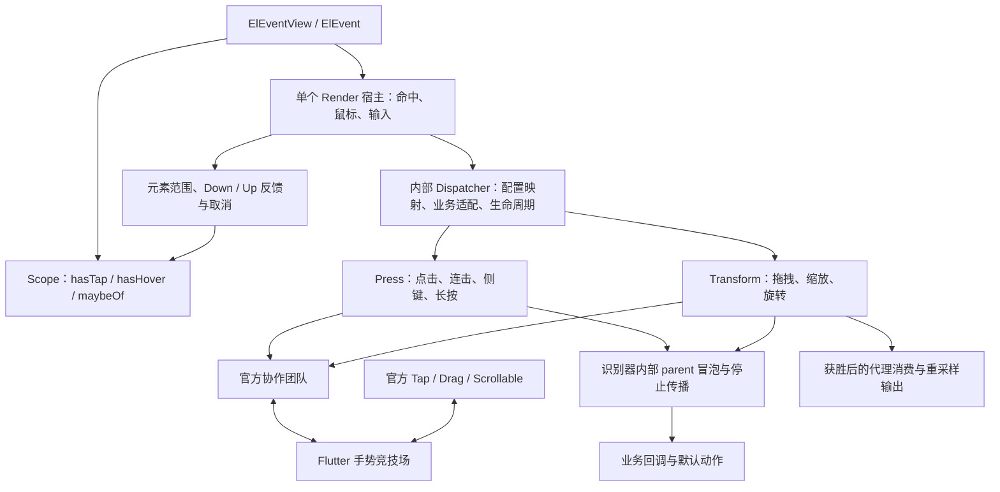

# ElEventView 接入自定义识别器计划与实施记录

状态：已完成代码切换、旧实现清退与自动化验收。真实设备输入尚待人工验收。

## 用户最终约束

- 事件是独立 Widget，不引入焦点、键盘、选择、窗口等模块。
- 公开状态只保留 `context.hasTap`、`context.hasHover`；`maybeOf` 读取最近宿主快照。
- `hasTap` 是 Down／Up 的样式反馈，Cancel 等终止行为会清理；读取状态不改变手势竞争。
- 主键点击是否竞争由 onTap／连击激活监听决定，纯 Down／Up 监听不占点击席位。
- 识别器保留自身冒泡和 stopPropagation；不依赖 ElEventConfig、ElEventCallback 或元素尺寸。
- 官方竞技场统一决定所有权，不能复活落败者。El 拖拽和官方拖拽双向互斥。
- ElEventView 保留单个 Render 宿主，内部按职责组织，避免 Widget 本身膨胀。

## 最终架构

| 文件 | 职责 | 不负责 |
| --- | --- | --- |
| `view.dart` | Widget、按字段订阅、单 Render 宿主、Hover 和命中 | 点击计数、阈值、速度、归属推断 |
| `dispatcher.dart` | 原始输入、配置映射、回调适配、代际检查和成员协调 | 点击或拖拽识别算法、替代官方的竞技场 |
| `interaction.dart` | 输入快照、元素资格、反馈计时、显式官方席位 | 识别计时与速度拟合 |
| `drag/output.dart` | 已接受拖拽的重采样、pre / driver / overflow 消费 | 手势竞争、输入速度识别 |
| `recognizers/press.dart` | 单双三击、侧键、长按、各成员独立历史与资格 | Widget 几何、样式、业务配置 |
| `recognizers/transform.dart` | 拖拽、多指缩放旋转、真实输入速度 | 上层拖拽升级策略、代理消费 |
| `recognizers/route.dart / team.dart` | 同类冒泡、终态配对、官方团队协作 | 强行复活官方落败者 |

## 实施步骤

- [x] 冻结职责边界，确认成员资格必须在点击历史提交和长按认领前检查。
- [x] 扩展必要纯原语：成员取消、仅拒绝点击、资格检查、接受和物理释放通知。
- [x] 引入官方团队协调 Press／Transform，外部获胜时统一拒绝团队。
- [x] 按点击意图区分团队，防止内层长按替外层点击抢占中间官方 Tap。
- [x] 连接配置、回调、停止标记与默认动作，不在宿主重建普通手势冒泡。
- [x] 保留范围移出取消／移回恢复、按压反馈时间和按字段订阅。
- [x] 连接 Drag、Scale、Rotation、PanZoom、代理消费与输出重采样。
- [x] 处理配置替换、回调重入、禁用子树、延迟点击、重挂载和卸载。
- [x] 删除旧 sequence、tap、side-button、drag、scale 状态机和旧管线。
- [x] 识别器测试仍只有 Press／Transform 两个入口，宿主契约由对应模块测试负责。
- [x] 同步识别器说明、公开注释与下表中的兼容差异。
- [x] 完成最终模块测试、示例页测试、静态检查；提交按本次文件范围执行。
- [ ] Windows 鼠标侧键／触控板与 Android 触摸／滚动／多指实际验收。

## 配置映射

| 上层配置 | 目标与处理 |
| --- | --- |
| doubleTapInterval / tripleTapInterval / deferTap | Press 参数与各成员独立的连击历史 |
| longPressDelay / longPressCancelDistance | Press 长按时间和设备移动容差，资格在接受前检查 |
| tapCancelOnMove / tapCancelDistance | 永久移动取消，或放宽主键容差并由宿主判断范围；侧键保留独立距离规则 |
| delayTouchDown / delayTouchUp | 只控制反馈；最短时长从物理 Down 起算，移回不重新起算，不推迟业务点击 |
| dragStartDistance / dragHorizontalAngle | Transform 阈值与锁轴参数 |
| dragMinFlingDistance / dragMinFlingVelocity / dragMaxFlingVelocity | Transform 真实输入速度计算与约束 |
| dragDevices | 只约束 Transform，不影响 Hover、原始指针或点击 |
| dragResampling | 只处理接受后的输出，End 前补齐尾部，不作为速度输入 |
| behavior / cursor / disabled / dragProxy | Render 宿主或业务适配，均不进入识别器 |

## 已明确的兼容差异

| 场景 | 当前规则与理由 | 回归位置 |
| --- | --- | --- |
| hasTap 与官方点击 | 读取样式或只监听 Down／Up 不竞争；声明激活回调才竞争 | view、interaction_state |
| 长按 preventDefault | 长按通知发生在官方接受之后；可阻止 El 排他和点击取消，不能撤销官方归属 | tap_gesture_contract、View 混合官方 Tap |
| 长按后拖拽／缩放 | 官方团队接受整个协作单位，各识别器仍维护自身状态；外部赢家拒绝整个团队 | recognizers/transform、pointer_ownership |
| 显式 eager | 只能请求尚存官方席位或在已赢的 El 团队内部独占；不能重新加入已结束的竞技场 | pointer_ownership、View 官方 Drag 后再次请求 |
| 不同轴向／阈值 | 不兼容的拖拽独立识别，首个真实接受者成为命中链的驱动；不向未达标后代反向派发提案 Start | drag_proposal_lifecycle_contract |
| 连击和长按参数 | Press 各成员独立冻结参数和历史，不把祖先配置当继承值 | recognizers/press |
| 回调和配置热更新 | 同形闭包可热更新；识别参数从下一次 Down 生效；声明结构变化结清旧路线 | drag_replacement_tap、event_dispatch_reentrancy |
| 中途新增手势 | 不为旧指针补报 Down，下一轮才能报名，防止更改已确认归属 | drag_replacement_tap |
| Drag 升级 Scale | 先唯一 DragCancel，再 ScaleStart；2→1 为 ScaleEnd，不额外补 scaleUpdate:1 | scale_atomic_upgrade |
| Up 快速甩动补救 | 不保留旧的 Up 端点阈值补救；Up 跳变不产生 Start、不进入位移或速度 | drag_velocity |
| 兄弟节点并发拖拽 | 两条输入路线分别向共同祖先配对 Start／终态，不聚合成旧的提案生命周期 | drag_proposal_lifecycle_contract |
| 原始 Move 与竞技场 | 官方先投递命中路径，再交 PointerRouter；已经发出的 raw Move 不能被后续接受结果追回 | pointer_ownership OWN1 |
| 设备移除 | 使用真实 Cancel→Removed 顺序，Removed 不重复结清 | drag_proposal_lifecycle_contract |

以上变化是契约差异，不能把旧测试改成通过就称为完全兼容；迁移测试保留关键业务断言，并增加下一轮可复用和官方竞争反例。

## 测试矩阵与验收记录

| 层级 | 覆盖内容 |
| --- | --- |
| Press／Transform 两个识别器文件 | 各按钮、连击、长按、冒泡、各级坐标、成员取消、多指、速度、重入、官方双向竞争与协作团队 |
| View 与状态 | hasTap 读写边界、官方 Tap 上下层、纯 Down 截断、长按夹层、Drag 双向互斥、边界恢复、反馈计时、Hover、GlobalKey 与卸载 |
| 业务契约 | 默认动作、配置合并、动态替换、子树禁用、延迟点击、重入终态、独占与缩放升级 |
| 拖拽输出 | 代理消费顺序、总 delta、重采样尾部与真实输入速度分离 |
| 示例页 | 点击、连击、按钮、冒泡、边界、官方组件混合，以及窄屏和放大文字可访问性 |

2026-10-23 自动化验收：

- `flutter test test/ui/event`：255 项通过。
- 在 example 中运行 `flutter test test/custom_gestures_page_test.dart`：12 项通过、1 项预览用例按原条件跳过。
- `flutter analyze lib/src/ui/event test/ui/event --no-pub`：无问题。
- `git diff --check`：通过。

代码规模按 Dart 文件统计，包含空行与注释，以本次实施前的 HEAD 为基线：事件目录从 22 个文件、12,691 行降为 19 个文件、6,592 行；`view.dart` 从 287 行降为 256 行；内部 Dispatcher 从 3,466 行降为 1,229 行。此处不作为更早的 el_ui 源仓库对比。

自动化验收不代表真实设备体验或性能已经测量。

## 源码入口

- [Widget 与状态订阅](/D:/project/flutter/flutter_base/lib/src/ui/event/view.dart)
- [内部宿主控制器](/D:/project/flutter/flutter_base/lib/src/ui/event/dispatcher.dart)
- [反馈与输入适配](/D:/project/flutter/flutter_base/lib/src/ui/event/interaction.dart)
- [拖拽输出](/D:/project/flutter/flutter_base/lib/src/ui/event/drag/output.dart)
- [独立识别器说明](/D:/project/flutter/flutter_base/lib/src/ui/event/recognizers/README.md)
