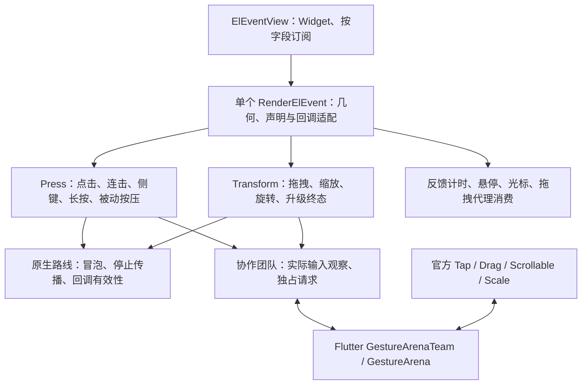

# ElEventView 独立手势接入与 Render 精简记录

状态：本轮职责收敛已完成，保留全部既有回归，并补充纯识别器验证。

## 目标与边界

- 删除 ElEventDispatcher；Render 直接复用 Press、Transform 的识别、冒泡与终态处理。
- Render 不保存另一份点击资格、竞技场接受标志、手势阶段或指针所有者。
- ElEventConfig 仅保存可空声明，识别器管理默认参数；构造器保留官方通用选项。
- ElEvent、ElEventConfig、ElDragProxy 继续使用模型生成接口，本轮没有修改生成器。
- 状态接口只保留 context.hasTap / hasHover 和 ElEventView.maybeOf。
- 不接入焦点、键盘、选择、窗口或全局触摸重采样。

## 职责划分

| 所在位置 | 维护的职责 |
| --- | --- |
| view.dart | Widget、hasTap / hasHover 按字段订阅、状态快照 |
| render.dart | 命中、父级挂接、禁用与卸载、范围判断、反馈及业务默认动作 |
| render_binding.dart | 参数与载荷映射、声明到处理器的选择、按需代理消费 |
| interaction.dart | 反馈的原始 Down 身份和两个计时器，不保存手势资格 |
| recognizers/press.dart | 被动与竞争按压共用生命周期，移动容差、资格取消与恢复、连击历史 |
| recognizers/transform.dart | 逐指官方接受、拖拽与变换、速度、Drag→Scale 的取消策略 |
| recognizers/route.dart | 冻结冒泡路线、终态义务、每个成员和手势家族的回调有效性 |
| recognizers/team.dart | 实际投递的原始输入与官方团队结果，协调独占和成员取消 |

## 本轮已完成

- [x] 删除 Render 的 `_ElementInput`、`_inputs`、命中参与表、手势快照、双手势版本号和独占处理链。
- [x] 不新增替代 Dispatcher 的宿主控制器；Press / Transform 的原生状态是识别结果来源。
- [x] `competeForTap = false` 的主键观察不占用官方席位，长按和侧键仍独立竞争；意图在 Down 冻结。
- [x] 资格函数由宿主提供，识别器负责移出 Cancel、移回 Down；移动容差或永久取消不恢复。
- [x] 团队以官方接受结果结算独占，不允许已落败的候选重新报名。
- [x] `cancelDragOnScale` 在 ScaleStart 前结清 Drag；取消回调重入不能漏发或重复终态。
- [x] `details.isActive` 按实际成员、路线和家族校验，不因取消别的指针或家族而误失效。
- [x] 反馈以物理 Down 身份区分同编号的新输入；旧回调的独占请求不能作用于下一次输入。
- [x] Render 只连接最近祖先；团队按点击意图、拖拽轴和阈值筛选自动冒泡，手工 parent 链默认保留原语义。
- [x] 保留拖拽代理的 pre / 主回调 / overflow 消费顺序，多鼠标悬停和光标更新。
- [x] 保留配置替换、禁用子树、延迟点击、GlobalKey 重挂、卸载和官方手势混用回归。
- [x] 同步示例页的新增取消原因，不修改其他会话的示例导航或 SDK 绑定工作。

## 本轮验收

- 事件模块 265 项通过，保留原有 251 项并新增 14 项；其中两个独立识别器测试入口合计 95 项。
- 新增验证覆盖被动观察、长按独立竞争、资格恢复、逐指取消、意图冻结、侧键优先级、纯团队独占、缩放升级与终态重入。
- 宿主回归补充保存的旧原始回调和旧语义回调不能独占同编号新输入。
- 自定义手势示例页 12 项通过，1 项预览按原有条件跳过。
- 执行事件源码与事件测试的静态检查、限定文件的差异检查。
- 仅验证改动涉及的模块，没有运行全库测试，也没有重新运行未修改的生成器测试。

## 规模与限制

按上一版提交 `f89795a` 对比，Dart 行数包含注释与空行：

| 文件或范围 | 上一版 | 当前 |
| --- | ---: | ---: |
| render.dart | 716 | 354 |
| render_binding.dart | 413 | 362 |
| interaction.dart | 200 | 72 |
| 三个宿主文件合计 | 1329 | 788 |
| 事件目录全部 Dart | 5638 | 5723 |

宿主减少 541 行；整个事件目录增加 85 行，主要用于识别器职责与独立协作。判断标准是状态归属和可独立验证，不能用宿主缩短冒充整体代码减少。

Windows 侧键、触控板及 Android 触摸和多指体验尚未实机验收。本轮未做性能测量，未更改全局触摸重采样。
