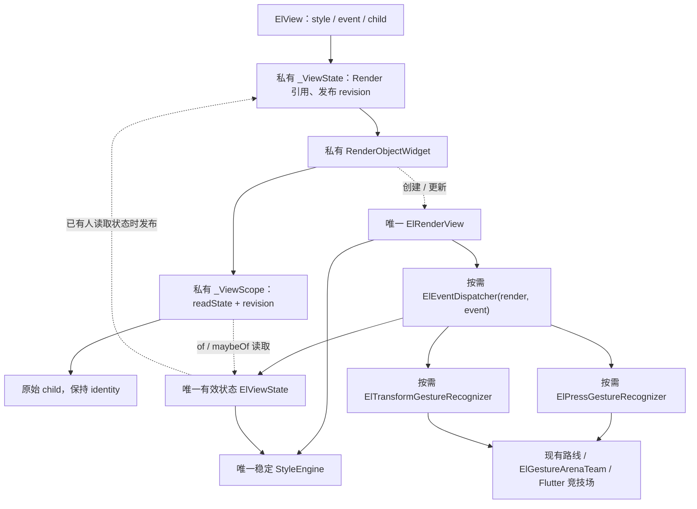
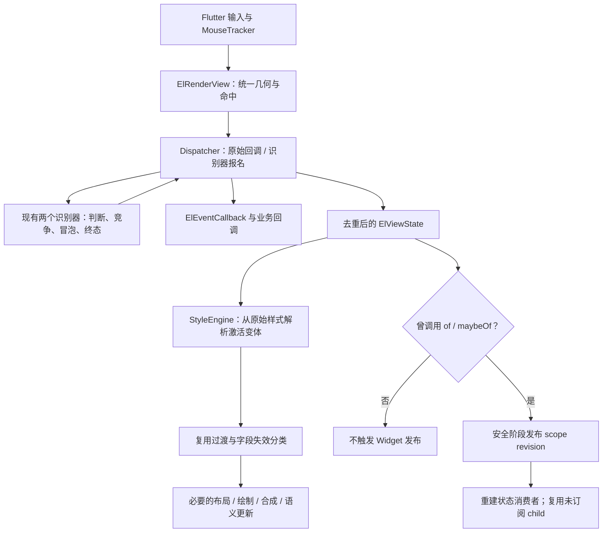

# ElView 事件集成与交互样式计划

日期：2026-10-24。

状态：第一步已按两参数构造重写并完成模块验证，结果见第 15 节。用户明确要求把当前模块一次写好，并非一次完成全部后续功能；本次停在 Dispatcher 与必需 Render 接入，不推进 ElView.of/maybeOf、状态模型和样式变体。

用户已确认保留 onHover/onTap 嵌套组合，并沿用旧版覆盖优先级。每完成一步必须停下供用户审核，汇报后续阻力、复杂度和实际行数；未经审核不进入下一步。

本计划以当前源码为基础，接替 `eleventview-recognizer-refactor.md` 中“删除 Dispatcher、独立 ElEventView”的方向。现有两个识别器及其路线、团队机制继续复用；恢复 Dispatcher 名称不意味着恢复旧手势状态机。

## 1. 本次目标与边界

1. 新建 `ElEventDispatcher`，封装当前事件宿主的配置、输入接入、反馈、回调适配和拖拽代理。
2. `ElRenderView` 组合持有 Dispatcher，直接承接事件，不再额外包裹 ElEventView/ElRenderEvent。
3. `ElStyle` 增加 `ElStyle? onHover`、`ElStyle? onTap`，支持嵌套组合。
4. `ElView.of(context)`、`ElView.maybeOf(context)` 返回不可变的 `ElViewState`，只包含 `hasHover`、`hasTap`、`disabled`。
5. 纯样式变化直接进入现有 StyleEngine；读取状态的 Widget 才通过 scope 接收重建通知。
6. 迁移本仓库现有调用方和测试，不保留两套运行时宿主，不修改旧参考仓库。

本次不扩展焦点、键盘、选中、暗色、断点、group、vars、onDisabled、投影和全局重采样。保留已有 ElEvent 的手势、原始输入、光标、拖拽代理、取消与反馈合同。

## 2. 源码核对结论

当前源码根目录：`D:/project/flutter/flutter_base`。

下表记录实现前基线，当前实现变化见第 15 节。

| 已确认事实 | 依据 | 对新方案的约束 |
| --- | --- | --- |
| Press/Transform 已负责官方竞争、同类冒泡、取消、连击及 Drag→Scale | `lib/src/ui/cores/event/recognizers/` | Dispatcher 不复制这些状态 |
| 当前 Render 仍负责配置替换、范围、反馈和代理消费 | `lib/src/ui/cores/event/render.dart` | 提取已有能力，保持重入防线 |
| ElView 目前只有 style/child，没有状态作用域 | `lib/src/ui/cores/view/index.dart:20` | 需要标准 Widget 组合，但仍只有一个 Render |
| StyleEngine 已实现稳定实例、逐字段更新和过渡接续 | `view/render/index.dart:18`、`view/style/style_engine.dart:261` | 变体求值复用现有引擎，不重做动画 |
| 当前自身命中依赖装饰字段 | `view/render/index.dart:472` | 无背景的事件/反馈节点也必须能够命中 |
| 背景图片环境当前只检查基础或当前有效样式 | `view/index.dart:31`、`view/style/style_engine.dart:102` | 未激活的图片变体也要声明环境需求 |
| GlobalKey 重挂需要保留当前按压序列 | `test/ui/cores/event/view_test.dart:394` | detach 不能等同于取消或销毁 |
| 现有普通 merge 中 null 表示未声明 | `view/style/index.g.dart:106` | 不承诺变体中的 null 可以清空基础值 |

旧参考根目录：`D:/project/my-project/el/packages/el_ui/lib/src/cores`。

- `event/dispatcher.dart` 本体 3272 行，另有 part 状态机；不整体迁入。
- `view/render/render_view.dart:2140` 提供可借鉴的组合持有与几何回调方式。
- `view/view.dart:93` 的 ElStyleContext/按位订阅体系不迁入。
- `style/cascade/style_spec.dart:198`、`decl_collector.dart:131` 提供顶层与嵌套优先级依据。
- 旧 hover 稳定范围仅保存局部矩形，没有完整保存当时的 transform；不能据其注释承诺任意反馈变换都稳定。

以上是计划初稿时的源码核对。第一步旧草稿的测试结果见第 14 节，不作为本次重新设计后的验证结果。

## 3. 公开使用方式

```dart
ElView(
  event: ElEvent(onTap: (_) => open()),
  style: ElStyle(
    backgroundColor: idleColor,
    onHover: ElStyle(
      backgroundColor: hoverColor,
      onTap: ElStyle(backgroundColor: hoverPressedColor),
    ),
    onTap: ElStyle(backgroundColor: pressedColor),
    transitions: [ElTransition.all()],
  ),
  child: Builder(
    builder: (context) {
      final state = ElView.of(context);
      return Text(state.disabled ? '不可用' : '打开');
    },
  ),
)
```

接口合同：

- ElView 保留 `style`、`child`，增加可空 `event`；静态节点默认不声明事件。
- `ElViewState` 是普通不可变值对象，不是 Flutter 的 `State<ElView>`，三个字段均只读，并具有值相等语义。
- `of` 读取最近的祖先 ElView；不存在时给出明确 FlutterError。`maybeOf` 不存在时返回 null。
- 两者均订阅整个三字段快照；不添加 aspect、listen、group 或 getter 级依赖追踪。
- 每次读取返回当时的快照，保存的旧快照不会原地改变。
- `hasTap` 表示按压反馈，沿用 delayTouchDown/delayTouchUp，不改成严格的物理按下标志。
- `disabled` 的唯一配置入口仍为 `ElEvent.disabled`；不再增加同义的 ElView.disabled 参数。
- disabled 表示本节点声明。祖先禁用阻断后代输入，但不把后代的 disabled 值改为 true。
- child 内部的 context 可以读取本节点；构造 ElView 时使用的外层 context 只能读取外层祖先。
- 现有 `context.hasTap/hasHover` 若保留，直接转发到新 maybeOf，宿主外返回 false；它们也采用整体订阅，不保留原按字段订阅系统。

## 4. 架构图

### Widget 与 Render 结构



ElView 使用标准 StatefulWidget 组合。Widget 的 State 为私有 `_ViewState`；不与公开 ElViewState 混用。scope 不创建 RenderObject，不手工操纵隐藏 Element/Render 子树。

### 一次输入的工作流



## 5. 类的职责与状态所有权

| 位置 | 负责 | 不拥有 |
| --- | --- | --- |
| ElView / 私有 Widget 桥接 | 参数、环境、of/maybeOf、scope 发布 | 手势阶段、样式计算、第二份交互事实 |
| ElRenderView | 命中、实时几何、坐标适配、设备配置、树关系、状态通知与生命周期 | 点击/拖拽算法、变体覆盖规则 |
| ElEventDispatcher | 参数映射、输入接入、反馈、有效状态、回调适配、dragProxy；直接使用具体 Render 宿主 | 布局绘制、样式树、独立手势状态机 |
| Press / Transform / Team | 当前已有识别、路线、竞技场与终态合同 | Widget、StyleEngine、组件尺寸 |
| StyleEngine | 原始声明、变体求值、有效目标、动画与失效 | 原始 Pointer、鼠标设备集合、业务事件 |

ElViewState 直接替代现有 event/event.dart 中的 ElEventState，事件入口与 view 入口按需导出同一类型。不再新增 StateSource、StateResolver、Context、Snapshot、Change 等并行模型。Dispatcher 允许依赖具体 ElRenderView，但不直接使用样式引擎；两个识别器继续独立于 View 和 Style。

Dispatcher 只保留一份有效 ElViewState。鼠标设备集合和触摸反馈计时属于产生该状态的内部输入事实；禁用时保留真实鼠标位置信息，公开的 hasHover/hasTap 均为 false。

构造严格收敛为两个位置参数：

```dart
ElEventDispatcher(ElRenderView render, ElEvent event);
```

这里选择具体的 ElRenderView，而不是任意 RenderBox：当前任务就是服务 ElView，宿主自己的变换、margin、clip 和状态发布也需要具体实现。直接组合比再增加宿主接口或注册表更短、更明确。

- Dispatcher 保存 `final ElRenderView _render` 与当前 ElEvent，不接收几何、反馈、设备配置或后代取消回调。
- 不把删除的构造参数搬到 setter、options 对象或另一组依赖注入入口。
- 几何与坐标通过 Render 的具体内部方法访问；该方法计入 ElView 的自身变换与实际视觉盒，不能仅使用 RenderBox.size/globalToLocal。
- 设备手势配置和是否需要被动反馈由 Render 保存，Dispatcher 更新配置时读取；相同 event identity 不能吞掉设备配置更新。
- Render 接收 handleEvent/MouseTracker 并转发；Dispatcher 直接调用 Render 的单一状态变化入口，由 Render 更新样式及通知 Widget。
- 父链和禁用后代通过实际 Render 树处理，只在具体 ElRenderView 上读取其 Dispatcher；不创建全局 Expando 注册表或可写的外部 Dispatcher.parent API。
- Dispatcher 内部继续连接已有 Press/Transform/Team 的父链，新输入前刷新连接；在途路线仍由识别器冻结。
- Render 唯一持有并释放 Dispatcher；构造初始化不得在 Render 尚未保存实例时反向读取该实例，禁用子树等外部副作用在保存实例之后执行。
- 保留 `event` 更新、`handleEvent`、鼠标 enter/exit、只读状态/光标、`cancelAllPending` 和 `dispose`，不暴露第二套事件控制器。

上述 Render 内部成员属于同模块协作入口，按需要使用 `@internal` 和中文注释，不新增 Host 基类、mixin、接口或 manager。Dart 文件可以互相引用；私有成员不能跨库访问，不能通过 dynamic 绕过类型检查。

配置版本与 disposed 检查继续保留，用于保护业务回调重入；它们不是另一套手势状态机。拖拽代理沿实际祖先宿主找到 Dispatcher，保留 pre → 当前消费者 → overflow 顺序与余量共享。

## 6. 按需启用与状态发布

| 使用情况 | Dispatcher | Press | Transform |
| --- | --- | --- | --- |
| 静态样式，无事件、无状态读取 | 不创建 | 不创建 | 不创建 |
| 只有 hover 变体或鼠标相关能力 | 创建 | 不创建 | 不创建 |
| 只有 tap 变体 | 创建 | 被动观察 | 不创建 |
| 只有 of/maybeOf 状态读取 | 创建 | 被动观察 | 不创建 |
| 点击、连击、侧键、长按 | 创建 | 按现有规则竞争 | 按需 |
| 拖拽、缩放、旋转 | 创建 | 按反馈/点击需求 | 创建 |

嵌套声明也参与需求检查；例如 hover 内含 tap，仍必须具备按压反馈能力。仅观察状态不能制造 onTap 点击意图，也不能抢走官方子组件的点击。

不为订阅计数引入自定义 Element。采用明确的小取舍：首次 of/maybeOf 成功读取后，当前 ElView 实例持续开启状态观察直到销毁，不实现“最后一个读者离开就立即回收”。从未读取状态的静态节点仍保持零识别器。

发布规则：

1. `_ViewScope` 位于私有 RenderObjectWidget 的 child 内，保证后代读取时 Render 已创建。
2. scope 只保存 `readState` 回调和私有发布 revision；of 实时读取 Render 暴露的 Dispatcher 快照。
3. Dispatcher 实际状态变化时，Render 同步更新 StyleEngine。未曾读取 of 时，不调用 Widget setState。
4. 进入观察模式后，每次实际状态变化递增发布 revision；scope 据此通知整体依赖。
5. 不用 scope 内的旧状态值判定通知，避免“首次读取最新 true，但 scope 仍为旧 false，随后变回 false 时漏通知”。
6. build/layout/拆树期间只合并发布请求，安全阶段再通知；不缓存旧状态副本，读取始终以 Render 当前状态为准。
7. 销毁时解除回调；发布前检查 mounted 与当前 Render 身份。保持原始 child identity，未依赖 scope 的业务 child 不被无故重建。

私有 revision 仅标识通知，不加入公开 ElViewState，也不参与手势有效性判断。

## 7. 样式变体规则

### 覆盖优先级

沿用用户确认的旧合同：

1. 基础字段先应用。
2. 同一层级 onHover 先、onTap 后；相同字段由后者覆盖。
3. 嵌套路径表示 AND：onHover.onTap 仅在 hover 与 tap 同时成立时激活。
4. 更深的激活路径优先于所有浅层路径。
5. 同深度按路径中的 hover → tap 槽顺序稳定覆盖。

例如 hover+tap 同时成立时，onHover.onTap 的背景色覆盖顶层 onTap；若另有 onTap.onHover，则同深度后者覆盖前者。

只需要两个条件槽：采用按深度逐层遍历激活分支，避免旧通用收集器、全量排序、状态枚举位表。不能采用“先递归完 hover 再处理顶层 tap”的简单 DFS，因为这会让浅层 tap 反盖深层组合。

### 求值与合并

- 每次从原始 ElStyle 重新求值，退出状态恢复基础字段，不能在上次有效样式上继续叠加。
- 没有相关变体或有效状态未变化时走快路径；相同有效属性不能重启无关动画。
- onHover/onTap 是条件声明，不加入 StyleField 可动画字段表。
- 条件元数据不作为普通属性参与有效样式叠加；解析时只叠加对应节点的实际样式字段与 transitions。
- 两个新变体槽采用 `@ElFieldGenerator(useMerge: false)`，更新分支时整体替换；`copyWith(onHover: null)` 删除整个分支，避免生成器自动深合并导致旧嵌套残留。
- 普通字段保留现有 merge 语义：null = 未声明。`onHover: ElStyle(width: null)` 不表示把基础 width 清空为 auto。
- 本轮不引入 unset/reset 哨兵，也不修改通用模型生成器。确实需要清空某个基础字段时，应后续单独定义明确的声明语义。
- transitions 使用同一套深度/槽优先级；列表整体覆盖，null 沿用低优先级配置，空列表表示不声明过渡。
- 切换后的有效目标决定 transitions，沿用现有引擎规则。若希望进入和退出都动画，可在基础样式声明 transitions。
- 中途反向从当前采样值接续；保留 auto、百分比、min/max、padding 等现有求值语义，不提前烘焙成固定像素。

### 环境需求

只在样式声明变化时检查整个变体树的图片需求。存在图片变体时，在 Widget 层按需取得 ImageConfiguration；未激活时不解析/订阅实际图片资源。退出动画仍使用图片时继续保留配置。

图片环境需求与“当前是否正在绘制图片”分别处理，防止 Render 暂时回到无图片样式时丢掉下一次 hover 所需的环境。文字方向和设备手势配置仍走现有 Flutter 环境入口。

## 8. 几何、鼠标与禁用

- 命中统一经过 ElRenderView 已有透明度、变换、clipper 和形状逻辑，不直接照搬事件 Render 的裸 size.contains。
- padding 属于视觉盒，margin 不属于自身反馈范围。仅声明事件或变体的无装饰节点也能命中。
- 未启用交互的静态节点保持原有命中行为；启用后应用 ElEvent.behavior，纯反馈采用明确的默认盒命中行为。
- 原始 Pointer 仍由宿主交给 Team 观察；Down/PanZoomStart 再向识别器报名，不能重复投递后续手势 Move/Up。
- 手势详情已有各级局部坐标；原始输入和代理余量使用 Render 的几何适配。尤其要计入 ElView 自己的 paint transform，不能只依赖裸 globalToLocal。
- 新 PointerDown/PanZoomStart 前刷新当前 Render 祖先链，处理祖先后来才启用事件的情况；当前序列继续使用识别器已冻结路线。
- 禁用阻止后代获得新输入，按当前盒区域阻止点穿，并结清本节点及后代在途事件/延迟点击；子节点的 disabled 声明不被改写。
- 禁用使有效 hasHover/hasTap 为 false；内部保留真实鼠标驻留信息，解除禁用后静止鼠标也能恢复 hover。旧按压不能复活。
- 光标、禁用、交互能力变化按需请求鼠标重算，不因此直接触发布局或绘制失效。

反馈变体改变几何需要专门验证，不能宣称天然稳定：

- hover 的尺寸/自身 transform 反馈可在帧后 MouseTracker 重算时使用进入前几何兜底；真实指针移动仍按实时几何离开。
- tap 的范围资格可使用反馈前与当前自身几何的并集，避免反馈缩小导致立即取消。
- 几何记录必须包含相关自身变换，比较应落在当前祖先坐标空间，不能保存永久 global 矩形造成滚动后的幽灵区域。
- 记录仅用于已有反馈的稳定，不让新的真实点击在已移开的区域触发，也不绕过当前 clip/opacity 门禁。
- 按需保存私有几何记录，不增加公开几何管理器。先以针对性的无头测试确认这条路径可实现且不影响兄弟命中，再纳入实现。
- opacity 变为零、裁剪主动排除指针等声明仍遵守命中规则，不承诺所有几何变化都保持 hover/tap。

## 9. 生命周期与回调顺序

| 情况 | 处理 |
| --- | --- |
| 首次创建 | 创建稳定 StyleEngine；按需求创建 Dispatcher 与识别器 |
| 同形回调闭包替换 | 保留已有识别器和手势，只更新回调目标 |
| 回调结构/配置变化 | 沿用当前取消合同，回调后检查配置 revision 和 disposed |
| 中途新增识别能力 | 仅后续输入报名，不补报旧 Down、不复活已败候选 |
| 状态反馈变化 | 同步更新引擎；按第 6 节决定是否发布 scope |
| GlobalKey 重挂 | 保留 Render、Dispatcher、当前手势和动画；刷新未来输入的祖先关系 |
| detach | 不当作最终卸载，不直接 cancel/dispose；遵循当前重挂合同 |
| 真正 dispose | 断开 Widget 通知，唯一结清终态、计时器、路线、代理与鼠标内部记录 |
| 指针编号复用 | 沿用物理 downEvent 身份，旧回调不得独占或清除新序列 |

保留现有顺序：本次 Up 及同轮立即触发的 Tap/连击回调完成后通知释放，避免状态消费者更新配置抢先替换本次业务回调。deferTap 的延迟单击继续独立等待，不延长按压反馈。取消引发的业务重入不能覆盖最新配置，也不能重复发终态。

## 10. 文件安排

| 文件 | 计划改动 |
| --- | --- |
| `event/dispatcher.dart` | 提取精简 Dispatcher；保留一个私有触摸反馈计时辅助 |
| `event/render.dart` | 完成迁移后删除 ElRenderEvent，不保留双实现 |
| `event/index.dart` | 移除 ElEventView 及旧状态作用域，保留事件/识别器入口与必要兼容转发 |
| `event/event.dart`、`event/event.g.dart` | ElEventState 收敛为唯一 ElViewState，按需要更新生成结果 |
| `view/index.dart` | ElView.event、of/maybeOf、私有 Widget/scope 与环境收集 |
| `view/render/index.dart` | 持有 Dispatcher、统一命中、生命周期和状态流转 |
| `view/style/index.dart`、`index.g.dart` | 增加两个变体字段，更新生成接口 |
| `view/style/style_engine.dart` | 原始/有效声明分离、状态驱动求值、复用现有 update |
| `view/style/variants.dart` | 若遍历/需求检查需要独立文件，以私有函数组织，不创建公开解析器类 |
| `components/list_tile/index.dart` | 改为 ElView.event + onHover/onTap，删除为颜色切换额外搭的 Builder |
| 现有事件测试及 test host | 改成最小配置的真实 ElRenderView 宿主，保留原合同断言 |
| 当前 view 测试与新增交互测试 | 验证状态、变体、动画、命中和环境 |
| `example/lib/src/pages/view/base.dart` 等真实调用方 | 仅完成旧 API 迁移，不重新设计演示页 |

路径除明确给出者外，均相对 `lib/src/ui/cores/`。实施前再次扫描实际调用方，包括 `test/flutter_base/sdk/binding/resampling_test.dart`。识别器目录原则上保持行为不变；只有宿主接入发现真实缺口时才做有针对性的修正。

## 11. 实施顺序

每阶段交付后必须停止，等待用户审核。审核报告包含：本步职责变化、针对性验证、实际代码行数（含注释/空行）、新增类型/状态所有权、下一步阻力。阶段内部出现需要改变职责边界的设计问题，先更新方案再实施。

### 阶段一：两参数 Dispatcher 与最小 Render 接入

1. 先运行将要迁移的现有局部测试，记录真实基线和已有失败。
2. 改写为 `ElEventDispatcher(ElRenderView render, ElEvent event)`，保持现有 Team、Press、Transform 和回调合同。
3. 为 ElRenderView 接通最少的事件、几何、树关系和生命周期入口；构造直接使用最终宿主，避免先绑定 ElRenderEvent 再换一套宿主。
4. 测试使用最小配置的真实 ElRenderView，不再要求 Dispatcher 脱离 Render 运行。
5. 核对纯观察不参赛、取消、回调重入、指针编号复用、dragProxy、多指升级、初始禁用与初始化重入。
6. 旧 ElEventView 的私有 RenderWidget 同步改为使用 ElRenderView，暂时保留既有状态 scope 以维持 ListTile/示例调用。移除旧 ElRenderEvent 运行时并迁移直接依赖它的测试；不能让新旧 Dispatcher 同时接管同一个节点。
7. 本步不实现 ElView.of/maybeOf、样式变体和新的 Widget 状态作用域。旧 Widget 外壳后续随状态调用方一起删除，不保留第二套事件 Render。
8. 停下审核两参数契约和最小宿主边界；通过后才进入阶段二。

### 阶段二：接入 ElView 与三字段状态

1. 增加唯一 ElViewState、标准 Widget/scope 与 of/maybeOf。
2. 在阶段一的 Render 事件接入上补充按需创建和无事件状态观察。
3. 落实状态发布 revision、帧阶段保护、禁用子树、GlobalKey 重挂与最终销毁。
4. 验证无事件但读取状态也有反馈，静态节点不创建识别器，无关 child 不重建。

### 阶段三：接入交互变体

1. 增加字段和分支替换声明，正常执行 `dart run build_runner build`，不手改生成文件。
2. 在 StyleEngine 内按已确定优先级求值，再走既有更新与动画管线。
3. 接入变体树的图片环境需求，验证非激活图片不提前 resolve。
4. 先验证几何反馈稳定策略，再接入有证据支持的最小实现。

### 阶段四：迁移与收尾

1. 迁移 ListTile、示例与其他真实调用方；移除 ElEventView/ElRenderEvent 和重复状态桥。
2. 更新架构测试：两个识别器继续只依赖 Dart/Flutter；Dispatcher 仅依赖具体 Render 宿主，不参与样式计算；公开状态只有一个。
3. 更新识别器 README 中宿主说明，不把原架构字符串断言当作必须保留的功能。
4. 跑所改模块的局部测试和静态检查，检查生成结果、残留旧 API、git diff。
5. 每步实现满足约束后，按仓库规范仅提交本次涉及文件；被要求重新设计的草稿不作为完成实现提交。

## 12. 验收矩阵

| 范围 | 必须验证 |
| --- | --- |
| 事件合同 | 原始输入、官方 Tap/Scrollable 混用、被动反馈、单/双/三击、长按、侧键、拖拽、缩放/旋转、代理消费 |
| 取消/重入 | 禁用父节点、结构变化、旧回调、新指针同编号、Drag→Scale、唯一终态、通知内更新配置 |
| 状态读取 | 最近作用域、嵌套隔离、of 缺失错误、maybeOf 为 null、首次读取最新状态后反向变化不漏通知 |
| 按需行为 | 无事件也能由变体/of 产生反馈；纯 hover 不创建 Press/Transform；静态节点不创建 Dispatcher |
| Widget 生命周期 | 未订阅 child build 计数不增加；既有输入/焦点/State 不丢失；GlobalKey 重挂保留当前手势 |
| 变体 | 基础/hover/tap、深层优先、同层顺序、退出恢复、删除分支、null 语义、transitions 覆盖 |
| 动画 | 颜色/尺寸/transform 中间值、快速反向、相同目标不重启、纯颜色不新增 layout |
| 几何 | 无背景节点、padding/margin、祖先与自身变换、clip、零透明度、反馈收缩、滚动后无幽灵区域 |
| 图片 | 仅变体有图片、正确 DPR/locale/bundle/direction、未激活不 resolve、退场资源生命周期 |
| 静止鼠标 | 禁用/恢复、光标更新、动态增加交互能力、真实移动退出与帧后重算的区别 |

测试限制：只运行受影响的 event/view/ListTile 模块及被修改的具体关联测试；使用无头 flutter test，低并发，不运行 flutter run/drive、不抢窗口、不跑全库或性能长测。外部会话造成的编译阻塞按仓库规定等待重试；普通失败直接定位。

## 13. 简洁与质量的验收标准

- 手势识别事实只在现有两个识别器；有效交互快照只由 Dispatcher 产生。
- 样式解析和动画只在现有 StyleEngine；Render 负责协议与具体几何。
- 公开状态只有 ElViewState 三字段；没有 ElStyleContext、外部 controller、状态位枚举或自建订阅系统。
- Widget 通道只有标准组合和一个私有 scope；不手写 RenderObjectElement 子树管理。
- ElView 仍只有一个 RenderObject；删除旧事件宿主后不留下两套反馈计时和两套状态源。
- 保留必要的重入、取消、重挂保护；不能为了缩短文件删掉边界行为。
- 比较完整宿主代码量与类型数量，不通过拆文件或把宿主逻辑塞进识别器制造“更少行数”。生成文件与测试分别统计。
- 不给未经验证的行数或性能承诺。以完整合同通过、职责唯一、调用链短和真实无关工作被跳过作为完成依据。

## 14. 第一轮草稿记录与重设计阻力

以下仅记录被要求重设计的回调注入草稿，方便审查成本，不代表两参数版本已实现：

| 范围 | 改前行数 | 草稿行数 | 差额 |
| --- | ---: | ---: | ---: |
| event/render.dart | 687 | 153 | -534 |
| event/dispatcher.dart | 0 | 668 | +668 |
| 上述运行时代码合计 | 687 | 821 | +134 |
| 本次涉及测试及测试宿主 | 1365 | 1687 | +322 |

统计为物理行数，含注释/空行，文档不计入运行时。当前增加主要来自保留旧 Render 接口和新的宿主注入边界，不能把拆文件称为总代码精简。新版通过具体 Render 依赖删除注入边界，最终还需删除旧宿主；实现前不承诺净减少多少行。

草稿验证：event 模块 271 项通过；静态检查只剩 event/index.dart 原有的 dart.dart 未使用导入告警。初始基线为 263 项通过、2 项架构断言失败，已校正导入白名单和 import/export 区分。过程中发现的测试宿主重复销毁已修复，并补充 Dispatcher 提前销毁后 Render 仍完成释放的用例。新版改写后必须重新运行受影响测试，不能沿用草稿结论。

新版预期复杂度：Dispatcher 的回调/配置映射较长但规则固定；真正需要保留的复杂点仍是取消重入、延迟反馈、拖拽代理和多指升级。两个识别器继续拥有手势算法，不增加手势状态机。宿主直连可以减少参数与转发，但不会消除这些已有行为要求。

后续阻力：

1. 两参数约束采用具体 ElRenderView 后，第一步需要同时接入 Render、改写旧 Widget 的内部宿主以及迁移直接使用 ElRenderEvent 的测试；改动面会比单纯提取文件更大。不能继续把完全无 Render 的 Dispatcher 当作验收目标。
2. ElRenderView 自身变换、margin 与 clip 决定实际事件坐标和范围，必须与其现有命中逻辑统一。
3. 构造、禁用和销毁都有同步业务回调，保存宿主实例与触发外部副作用的顺序必须明确。
4. 下一阶段的按需 Dispatcher 会使祖先后来才加入事件；新输入要刷新父链，同时保留当前手势的冻结路线。
5. 状态作用域发布、嵌套变体优先级、图片环境与几何反馈仍分别在后续阶段处理，不提前塞进第一步。

## 15. 第一阶段实际交付

完成范围仅为当前 Dispatcher 模块与必要宿主连接：

- 构造固定 `ElEventDispatcher(ElRenderView render, ElEvent event)`；几何、通知和环境均直接取自具体 Render。
- 删除字符串 phase 反查和完整的二次回调查表；普通手势绑定明确 phase 和当前回调读取器，反馈或代理重入之后才读取有效声明。
- 两个识别器的算法、事件数据模型及现有 Widget 状态作用域保持不变；没有新增手势状态机、Host 接口或注册表。
- 删除 ElRenderEvent；旧 ElEventView 只保留 Widget/scope，内部使用同一个 ElRenderView。没有另造兼容 Render 或整排旧 API 转发。
- 新输入刷新实际祖先关系，设备环境更新不依赖 ElEvent identity 改变；取消后代后重新检查配置版本，避免误取消重入产生的新输入。
- 构造先创建样式引擎再接入 child，先保存 Dispatcher 再触发后代取消；销毁幂等，销毁后的 detach 不再请求绘制，正常重挂继续保留输入。
- 真实事件几何包含自身变换、padding 和裁剪，排除 margin；旧事件 Widget 关闭百分比参照能力，保留原先透明的布局参照链。

实际物理行数（含注释、空行；文档和测试另算）：

| 文件 | 实现前 | 当前 | 差额 |
| --- | ---: | ---: | ---: |
| event/render.dart | 687 | 0 | -687 |
| event/dispatcher.dart | 0 | 627 | +627 |
| event/index.dart | 173 | 176 | +3 |
| view/render/index.dart | 538 | 699 | +161 |
| view/layout/box_layout.dart | 535 | 540 | +5 |
| 本步涉及运行时合计 | 1933 | 2042 | +109 |

Dispatcher 比上一轮 668 行草稿减少 41 行。完整接入与生命周期、几何处理后的运行时仍净增 109 行，不能宣称整个模块已经比当前仓库基线更少。简化体现在删除独立事件 Render、构造注入和重复回调查找，复杂点仍是已有反馈计时、业务包装、取消重入与代理消费。本步涉及的 16 个测试/测试宿主文件合计从 6611 行变为 7256 行，净增 645 行。

验证命令与结果：

- `flutter test test/ui/cores/event test/ui/cores/view test/flutter_base/sdk/binding/resampling_test.dart --concurrency=1 --reporter expanded`：556 项全部通过。
- 新回归覆盖两参数构造、当前闭包读取、取消重入新输入、提前释放、真实祖先/自身变换、margin/padding/clip、禁用阻断、环境更新、后来加入的事件祖先，以及旧包装的百分比参照与后代失效。
- 百分比参照测试修复前实际得到 50、应为 200；修复后为 200，祖先宽度变化后正确变为 150。
- 一并校正已有事件架构断言与重采样测试的过期路径，未改变重采样运行时。
- 定向 `flutter analyze` 覆盖 event、view、对应测试和 resampling_test：No issues found。
- 未运行全仓库测试、前台应用或性能测试。

审核后的下一步仍单独开展：将现有 Widget 状态桥收敛为 ElViewState 与 of/maybeOf，重点处理通知时机、读者重建和 GlobalKey 重挂；样式变体与按需识别器再按原阶段推进。当前未实现这些后续功能。
