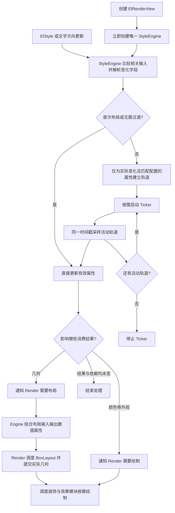
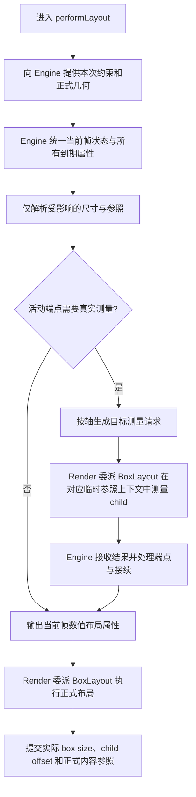
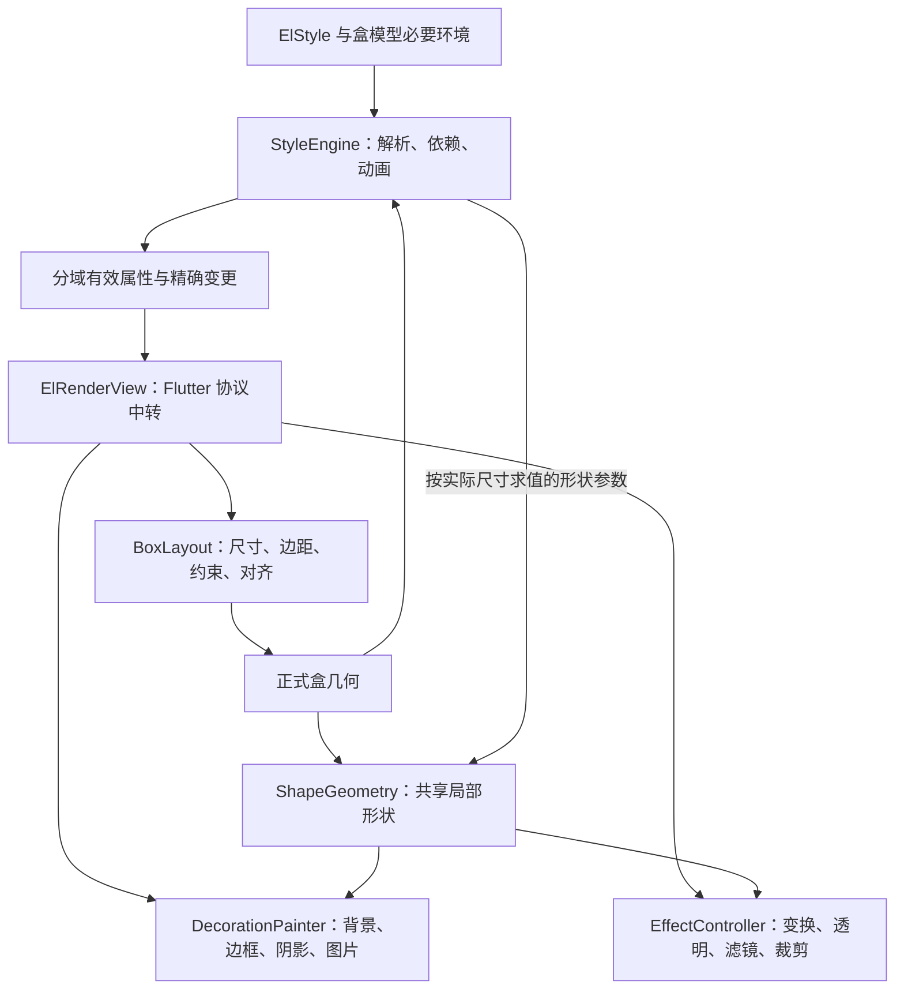
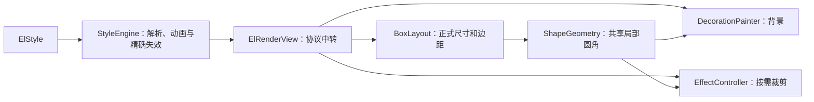

# ElView：StyleEngine 统一求值与按需渲染计划

日期：2026-10-23。依据：当前工作区源码与定向测试，基线提交 `6e948b9`。

执行状态：已按用户“执行”指令落实现有五属性的架构重构，见第 14 节。第 2 节保留重构前的调查证据；后续属性清单用于扩展归属，不代表已经全部实现。

## 1. 必须遵循的组织边界

- 最新范围约束：本阶段暂不处理文本和事件。只推进 StyleEngine、BoxLayout、ShapeGeometry、DecorationPainter、EffectController 所需的样式、几何、绘制与动画边界。
- 不实现文本/图标作用域、inline 排版、事件/焦点/选区系统，不创建对应 bridge、订阅、占位类或空接口。旧版完整属性清单中的相关条目仅作未来归属参考，不属于当前实施或验收范围。
- Directionality 等当前盒模型必要输入、已有基线与基础命中协议继续由 Flutter 框架入口提供，不因此引入文本或事件子系统。
- 每个 ElRenderView 在构造时创建唯一且稳定的 StyleEngine，生命周期与 Render 相同。
- StyleEngine 独占 ElStyle 的声明、解析、当前采样值、目标、属性依赖、过渡匹配、动画轨道和 Ticker。
- Render 是 Flutter 协议中转宿主：转交样式与环境，将 layout、paint、hit-test 等入口委派给独立执行器，并落地 size、parentData、markNeeds 等框架操作。盒模型、形状、装饰、效果的算法及缓存不放在 Render 内。
- 没有启用的属性跳过对应解析、测量、几何构造、绘制和资源创建；必要的分支判断和 Flutter 正常布局不属于可省略的属性处理。
- StyleEngine 必须立即创建；Ticker、轨道集合、百分比引用依赖、Paint 和未来的圆角几何按需创建。
- 当前 ElStyle 只有 width、height、backgroundColor、padding、margin 五个属性及 transitions 配置。实现分批推进，但架构按旧版完整 75 个声明字段设计，不能只为五字段划边界。完整覆盖见第 9—12 节。

## 2. 已完成的可行性核对

### 实测

1. `flutter test test/ui/view/view_test.dart --concurrency=1 --reporter expanded`：现有 23 项全部通过。
2. 临时实验：width 从 200 转 auto，child 自然宽 100，width 过渡 100ms；padding 从 0 转左右各 40，过渡 200ms。99ms 宽度为 180.2，100ms 为 140.0，确认存在截止帧跳变。
3. 临时实验：width/height 从 200/50 同时转 auto，分别过渡 100/200ms，child 为比例 2 的 AspectRatio。99ms 为 398×124.25，100ms 为 250×125，确认跨轴耦合下的截止帧跳变。
4. 临时实验：仅背景色过渡时，LayoutBuilder 执行次数保持 1，没有随颜色帧重新执行 builder；此计数本身不能证明真实 layout 方法从未被调用，真实调用计数列入后续验收。

临时实验断言的是当前行为，用于确认问题，并不代表重构后的算法已经验证通过。尺寸单位均为逻辑像素。

### 源码核对

- 当前 Render 和 StyleEngine 共同修改同一份 `_values`，并各有一份写入与失效逻辑。
- 当前 Render 遍历 `animation.active` 并修改轨道快照，样式/动画复杂度没有真正收进 engine。
- 当前 auto 测量传入整份 `animation.targets`，把其他仍在过渡的几何属性提前换成最终值，是上述组合场景的重要问题来源。
- Flutter 的 LayoutBuilder 不支持通过 dry layout 执行其 builder；auto 动画要保留对它的支持，就必须允许按需真实布局。
- Flutter 正式 layout 完成后会标记绘制；颜色单独 markNeedsPaint 可以避开 layout。
- dry layout 按框架合同不能修改正式状态，也不能依赖本节点或 child 的上次真实 size。

结论：用户指定的职责划分不存在必须由 Render 解析样式或管理轨道的障碍。组合 auto 动画的新采样算法、嵌套真实测量的状态边界仍需阶段一的最小实现验证，尚不能称为已验证通过。不能只把现有方法搬进 StyleEngine；必须同步处理测量上下文、动画截止帧和依赖失效边界。

## 3. 总工作流



父约束、child 的布局请求、祖先百分比参照变化及重新挂接也进入几何流程，不要求先有 ElStyle 更新。

## 4. Engine 与 Render 的数据合同

| 方向 | 数据 | 边界 |
|---|---|---|
| ElView → Engine，经 Render 转交 | ElStyle、文字方向 | Render 不拆解样式字段 |
| Render → Engine | 本次约束、上次正式几何、布局输入失效原因 | 不提供动画轨道操作 |
| Engine → 各执行器，经 Render 调度 | 分域的有效布局、形状、装饰、效果属性 | 不泄漏百分比字符串、变量表、混合表达、轨道或可变数组 |
| Engine → Render | 精确的布局/绘制失效通知 | Render 不重新对原始样式做一遍 diff |
| Engine → BoxLayout，经 Render 调度 | 按需的目标测量请求 | 请求中的布局属性已经解析，BoxLayout 统一执行盒模型与 child 测量 |
| Render → Engine | 请求对应的真实测量结果，以及最终正式布局结果 | Engine 自己更新端点、截止时间及依赖状态 |

输出中的 `width/height == null` 明确表示 auto，由 Render 根据 child 和父约束决定实际尺寸；数值宽高是求值后的样式尺寸，仍服从父约束。不能把“干净属性”误解为 engine 在布局前已经知道任意 child 的最终尺寸。

Engine 内部分开保存声明目标、当前采样表达和测量端点。BoxLayout 统一持有正式盒几何，Render 只同步框架要求的 size/offset。auto 完成后保留 auto 语义，百分比完成后保留相对尺寸语义，不能永久烘焙为测量像素。

输出按领域形成少量包内只读结构，执行器按第 10 节固定职责划分；不新增动态插件注册框架或额外 RenderObject。静态字段规格表只描述属性合同，不作为每帧遍历全部属性的管线。属性容器不得向 Render 开放可写索引。

## 5. 尺寸与动画的布局交换流程

以下图表确定职责和交换顺序；它不替代阶段一对动态端点采样数学及嵌套状态提交的验证。



### 时间与测量规则

1. 同一帧的所有字段使用同一时间戳。所有到期字段先统一恢复目标声明语义，再生成该帧的正式布局状态，避免宽高分别读到新旧状态。
2. 固定像素的普通插值不请求 auto 目标测量；混合 px+percent 表达由 engine 保留并按有效参照求值。
3. auto 端点测量使用当前帧有效 padding、margin 及普通数值轴的当前采样。双 auto 按截止时间从晚到早单向求值：某轴测量时，若另一 auto 轴会先完成，就使用其届时已恢复的 auto 语义；较早轴则使用较晚轴当前采样。这样不需要循环迭代，也不无条件传入整份未来目标样式。
4. 两个 auto 轴可能有不同的 child 约束。只有约束和临时祖先参照上下文都相同的请求才能合并；不能承诺所有情况只测一次。
5. 已完成的 auto 轴由正式布局直接决定尺寸，不先提交旧端点像素再切成 auto。未完成轨道的动态端点求值、采样和接续顺序必须通过组合回归验证，不能原样照搬旧 snapshot 时序。
6. 外部 child/约束/参照突变需要接续时，保留当前呈现和原截止时间、剩余 delay。引擎自身连续几何动画的动态端点如何采样，必须通过阶段一的组合与稀疏帧实验确定：同帧更新端点是否需要重新采样、何时只保持当前画面并重定后续轨迹，不能仅凭职责拆分下结论。验收应排除沿用整份未来目标导致的截止帧误差，同时保留外部突变的接续语义。
7. 相同目标或无关字段变化不重启轨道；移除过渡或使字段不再受过渡覆盖时立即应用目标；零时长加 delay 保持现有等待语义。
8. 父约束强制变化、child 按断点切换内容可能使自然几何离散变化。验收目标是消除 engine 混用未来/当前状态造成的额外跳变，不承诺任意 child 都具有连续的固有尺寸。
9. 对跨轴耦合不引入无界重测或迭代收敛。每次布局的测量请求数量有界；具体轨迹先由阶段一的组合回归确定。

### 临时测量与正式提交

- 真实测量可能触发 LayoutBuilder 和后代布局，不能把它称为无副作用纯计算。
- 测量期间，后代百分比必须看到该请求对应的临时内容参照，不能读到上次正式布局或另一份请求的参照。
- 临时参照按作用域恢复；本节点及参与测量的后代 engine，其正式几何、动画快照和依赖提交都要与临时测量分开，不能把探测结果当成已呈现帧。
- 最后一遍必须落实当前帧的正式 child 几何，不能只复用某份 Size 而让 child 留在另一份测量布局中。
- 嵌套 ElView、运行中的后代动画、LayoutBuilder 重建和 GlobalKey 重挂接列为先验验证项；不得假定真实测量能够自动隔离任意子树状态。
- 必要的重复真实布局及 LayoutBuilder 执行属于 auto 测量成本。任意业务 builder 的副作用不能通用回滚，方案不承诺这种回滚，也不通过复制完整子树实现隔离。

### 百分比引用

- 有界轴直接采用扣除当前 margin 后的可用尺寸。
- 无界轴只在存在相对尺寸需求时查询祖先；候选轴必须在 child 布局前已有确定盒约束，内容尺寸再减 padding，不能用 auto 自然尺寸反向建立循环参照。
- Render 提供树结构和内容几何查询，Engine 决定何时需要查询及如何解析表达式。
- 依赖按轴登记，覆盖查询途中可能变为最近参照的候选祖先；约束/内容参照变化只通知相关依赖。
- 没有相对尺寸就不查找、不登记、不扫描后代；解除依赖、detach/reparent 时清理过期关系。
- 无参照时保留现有 auto 回退；参照消失/恢复的活动动画由 Engine 接续。

## 6. 各类变化如何按需处理

| 场景 | Engine 工作 | 对应执行器工作 | 应跳过的工作 |
|---|---|---|---|
| 空样式 | 保存缺省语义 | 正常传递约束和布局 child | Ticker、轨道、边距运算、参照查询、背景 Paint |
| 固定宽高 | 解析变化的轴，输出数值 | 执行盒约束与 child 布局 | auto 目标测量、祖先参照查询 |
| 固定宽高动画 | 采样活动轴并通知布局 | 应用当前尺寸 | 重建 child、重新解析未变化的声明 |
| 百分比或混合长度 | 对受影响轴按当前参照求值 | 提供几何输入、执行布局 | 无关轴查询、无界后代全树扫描 |
| auto 活动端点 | 按实际依赖生成测量请求、处理接续 | 必要时真实测量，再正式布局 | 没有未解析端点时的目标测量 |
| padding 变化 | 解析物理边距、采样、使相关端点失效 | 更新 child 约束和偏移、盒尺寸 | 不相关属性解析和背景对象创建 |
| margin 变化 | 更新物理边距及相对尺寸参照 | 更新外占位和整体偏移 | 没有 margin 时的 deflate/inflate |
| 仅背景色变化 | 预乘 alpha/跨色域插值，只通知 paint | 更新背景颜色并绘制 | layout、dry layout、auto 测量、几何重新求值 |
| 背景色转 null | 完成透明过渡后输出 null | 停止背景绘制，按现合同更新自身命中判定 | 创建或执行无背景绘制 |
| 仅文字方向变化 | 只重新求值受方向影响的声明 | 仅在有效几何变化时布局 | 重解析无关宽高和颜色 |
| 父尺寸或 child 请求布局 | 仅更新受布局输入影响的结果和活动端点 | 正常布局 | 重启动画、重新解析未变化的原始样式 |
| 圆角，未来扩展 | 解析/插值有效圆角 | 按需构造形状、绘制；若参与裁剪/命中则更新对应几何 | 无圆角时的 RRect、Path、clip、saveLayer |

圆角等形状缓存还依赖实际 box size；尺寸变化即使圆角声明不变也要使相关形状失效。纯颜色变化不重算形状。仅背景圆角不自动等同于 child 裁剪。

绘制仍按 Flutter 正常 paint 流程进行；“颜色只重绘”表示不触发布局，不承诺 child.paint 永远不会被框架调用，也不默认增加 RepaintBoundary 或额外图层。

## 7. dry layout、固有尺寸与生命周期

- dry layout、intrinsic、baseline 使用调用方给出的假设约束进行只读求值，不复用上次真实布局的数值宽高缓存。
- 只读求值不启动 Ticker、不修改动画时钟/端点、不登记引用、不提交偏移和正式几何，不用真实 child.layout 替代 dry 查询。
- 不扩张 Flutter 本身不支持的 LayoutBuilder dry/intrinsic 能力；真实 auto 动画通过真实测量支持它。
- 首次挂载直接显示目标值，声明 transitions 本身不启动 Ticker。
- 保持当前不订阅 TickerMode 和系统动画开关的行为。
- 同一 Render 的 GlobalKey 重挂接保留 engine 和动画；更新布局上下文并清理旧引用依赖。
- dispose 释放 Ticker 与依赖；detach 不等同于 dispose，不能擅自销毁仍会重挂接的 engine。

## 8. 实施顺序与验收门槛

### 阶段一：先固定组合语义和交换协议

- 先完成第 9—12 节全属性到模块、输入依赖、失效、资源生命周期的覆盖表，再落实代码边界；不能只把当前五字段从 Render 搬到另一个大类。
- 为 auto+padding/margin 不同时间线、双 auto+AspectRatio、首次大跨度帧推进、截止前后小步推进建立回归场景。
- 补嵌套 Column 百分比、目标测量期间的临时参照、后代已有动画和 LayoutBuilder 重建场景。
- 明确按轴测量请求、动态端点采样与截止帧顺序，以及后代 engine 的临时/正式状态提交规则。这两项是实施前的算法验证门槛，本阶段落实与回归结果见第 14 节。
- 先用最小验证实现验证协议，再进行完整职责迁移，不以仅移动现有代码作为完成；若无法在有界真实测量内满足组合合同，应先修订测量算法和相应图表，再动生产代码。
- 通过门槛：正式 child 几何一致，无未来目标混用造成的额外跳变，测量次数有界。

### 阶段二：StyleEngine 接管样式

- 修改 `style/style_engine.dart`，构造时接收原始 ElStyle 与环境，内部拥有所有解析值和轨道。
- 必要的长度、边距与输出结构放在 style 目录；`lerp.dart` 的内部表达不向 Render 泄漏。
- 初始只处理已声明字段；后续只解析相关输入发生变化的属性；Ticker 和轨道容器延迟分配。
- Render 构造时创建 engine；applyStyle 仅转交，删除 Render 的原始样式比较、字段读写、重复 damage 累计。
- UI 入口不导出内部解析类型和测量协议，保留现有 ElView/ElStyle/ElTransition API。

### 阶段三：Render 接入独立执行器与布局交换

- `render/view.dart` 只保留生命周期、精确失效响应和 Flutter override 的转发，不保留盒模型与绘制业务算法。
- 将现有布局 extension 升为独立 `BoxLayout` 类，集中尺寸、内外边距、约束、child 对齐、真实/dry/intrinsic/baseline 与正式几何。
- 当前背景色绘制放入 `DecorationPainter`，使用简单矩形分支；未来加入边框、阴影、图片等时扩展本模块，不回填 Render。
- 预先固定 `ShapeGeometry`、`EffectController` 的输入输出与失效边界；按功能实际接入创建，不能为空占位给每个节点分配一套控制器。StyleScopeBridge、InteractionBridge 留待后续文本/事件阶段，不实现接口或占位对象。
- 删除 Render 中的 StyleLength、ElTransitionField 分支、active/track/snapshot 访问。
- 按阶段一协议接入 auto 测量、百分比依赖和只读布局查询。

### 阶段四：验证按需路径

- 通过计数 child RenderBox/布局回调、解析探针和绘制记录，验证真实操作次数，而不仅检查最终截图或 dirty 标志。
- 空样式和静态样式无 Ticker；初始声明 transitions 但值未改变也无 Ticker。
- 纯颜色更新/动画不增加 layout、dry layout、端点测量或尺寸/边距解析次数。
- 固定数值动画不走百分比引用或 auto 测量；布局依赖未变化时不重复测端点。
- 未声明边距不做边距转换；没有背景不创建背景 Paint；不存在圆角能力就不增加占位形状操作。

### 阶段五：针对性验收与文档

- 保留并通过现有 23 项合同测试，补充上述组合和按需回归。
- 仅执行 `test/ui/` 的相关测试和改动目录的静态分析；不主动跑全量套件。
- 更新 README 中的职责、工作流、扩展方法和测量开销说明。
- 有意义的代码重构完成后按仓库规则提交本会话文件，保留其他会话的在途改动。

完成标准：一个 Render 对应一个从构造存在的 StyleEngine；所有 ElStyle 语义和动画归 engine；盒模型、形状、装饰、效果各有独立职责；Render 无轨道、原始表达式或领域算法；现有行为与组合边界通过；未启用能力没有对应运行操作。功能测试和调用计数不替代设备 Profile 性能结论。

## 9. 旧版全属性覆盖清单

本节是未来完整性参考，不是本阶段任务清单。文本、图标环境、inline、事件、焦点、选区相关字段与桥接全部暂缓。

本节按用户指定的 `D:/project/my-project/el/packages/el_ui/lib/src/cores/style/` 当前源码提取，采用字段定义与实际生成规格，而非旧注释计数。

普通 ElStyle 构造函数恰有 75 个参数，对应 75 个存储字段：56 个能力属性 + 19 个声明控制字段。统一 longhand 表包含 54 个字段；userSelect、verticalAlign 是另外 2 个特殊消费字段。ElStyle.builder 是独立工厂入口，不混入 75 的计数。

| 领域 | 数量 | 完整字段 | 主要消费模块 |
|---|---:|---|---|
| 盒布局 | 12 | width、height、minWidth、maxWidth、minHeight、maxHeight、widthFactor、heightFactor、aspectRatio、padding、margin、alignment | BoxLayout |
| 形状与裁剪声明 | 3 | borderRadius、clipper、clipBehavior | ShapeGeometry 提供几何，EffectController 执行裁剪 |
| 装饰 | 6 | bgColor、gradient、bgImage、border、outline、boxShadow | DecorationPainter |
| 效果与变换 | 5 | opacity、transform、transformAlignment、filter、backdropFilter | EffectController |
| 文本 | 23 | color、fontSize、fontWeight、fontStyle、fontFamily、fontFamilyFallback、fontFeatures、fontVariations、lineHeight、letterSpacing、wordSpacing、textAlign、textBaseline、leadingDistribution、textShadow、decoration、decorationColor、decorationStyle、decorationThickness、textBackgroundColor、softWrap、overflow、maxLines | StyleScopeBridge 与文本消费者 |
| 非文本继承环境 | 5 | textDirection、cursor、pointerEvents、iconSize、iconColor | 布局求值、StyleScopeBridge、InteractionBridge |
| 特殊消费 | 2 | userSelect、verticalAlign | 选区消费者、inline 文本布局消费者 |
| 变量 | 1 | vars | Engine 变量与依赖求值 |
| 响应式变体 | 5 | xs、sm、md、lg、xl | Engine 声明选择 |
| 状态/选区声明 | 8 | onHover、onTap、onFocus、onFocusVisible、onFocusWithin、onDisabled、onSelection、onDark | Engine 状态求值；onSelection 供选区外观消费 |
| group | 2 | group、groupVariants | Engine 祖先状态依赖 |
| 动画控制 | 3 | transitions、animations、starting | Engine 统一动画调度 |

旧版实际行为还需区分：

- 23 个文本字段及 5 个环境字段在实际生成规格中均按继承处理；部分声明注释将某些文本字段标成非继承，与实现矛盾。迁移时应逐字段明确合同，不能照抄矛盾注释。
- userSelect 与 verticalAlign 不进入普通 cascade/动画；onSelection 不等于普通状态变体，只提供选区外观。这些属性必须有归属，不能为了通用处理而强塞进同一管线。
- builder 需要本节点 Element 的 BuildContext；StyleEngine 统一拥有求值规则，Element 桥在合法生命周期提供上下文并登记依赖，不能在 paint/layout 内任意调用依赖 Widget 的 builder。
- 文本与图标的官方作用域更新允许对应 Text/Icon 正常重建；不能将“颜色最终只影响绘制”错误承诺为所有 Widget 零 build。

## 10. 独立类、唯一所有权与扩展边界

### StyleEngine：唯一语义入口

统一拥有声明、变量/继承/变体求值、字段依赖、当前/目标值和动画时钟。内部可按声明选择、字段解析、动画采样组织私有协作者；这些协作者不再拥有第二份独立当前样式或第二套动画调度。

输出按布局、形状、装饰、效果、文本/图标、交互分域。缺省组采用共享默认值，变化时只更新相关组；不要求每帧为全部组创建新对象。执行器不接收 ElStyle、vars 或可变轨道。

### BoxLayout：尺寸和内外边距统一执行

需要独立 class，且尺寸、padding、margin 不拆成三个各自管理几何的 controller。三者共同决定外占位、视觉盒、内容区域、child 约束和偏移，分开拥有状态会制造重复计算与来回协调。

BoxLayout 还负责 min/max、factor、ratio、alignment 的几何组合，以及真实布局、dry、intrinsic、baseline 共用的盒模型规则。Engine 负责表达式解析、声明级联优先级和动画；几何约束的组合与优先顺序由 BoxLayout 唯一执行，不能在 Engine 再复制一份 deflate/min-max/内容盒算法。

输出并唯一管理 `layoutSize`、`boxSize/boxOrigin`、`contentRect`、`childConstraints/childOffset` 和确定内容参照。Render 只在框架要求处调用 child.layout、设置 size/parentData，或通过窄接口让 BoxLayout 请求这些操作；不得再在 Render 中复制约束算法。

### ShapeGeometry：共享形状

按需持有局部 Rect/RRect/Path、圆形特殊几何、contains 和 clip bounds。有效圆角的长度/方向/变量语义由 Engine 求值；该类负责把数值参数与实际 boxSize 组合成可复用几何。

同一基础形状供背景、图片 mask、gradient 填充、阴影、边框/轮廓、child clip、backdrop 采样和命中复用。边框/outline 可在该基础上派生自己的描边几何，不得各自重新解析圆角。

clipper 的监听与 reclip 失效集中在形状模块；临时/正式布局不得互相覆盖其正式几何缓存。没有形状消费者时不为了 borderRadius 声明本身无条件建 Path。

### DecorationPainter：装饰与资源

负责背景色、渐变、背景图、边框、outline、内外阴影及固定绘制顺序。内部按实际使用创建 shader、图片订阅和绘制产物；简单纯色矩形直接 drawRect。

颜色与路径输入分开：背景色变化不重建形状，边框颜色变化不重建边框路径；图片就绪回调只通知相关绘制和资源更新。图片替换/移除时处理订阅与 painter 释放。

### EffectController：合成和坐标

负责 transform/origin、opacity、filter、backdropFilter 和裁剪的实际包裹顺序、矩阵/逆矩阵、layer 复用及合成切换。

Engine 输出已解析参数；本模块生成/维护实际矩阵和效果资源。paint、inverse hit-test、applyPaintTransform、语义及选区坐标使用同一几何来源。clip 使用 ShapeGeometry；backdrop 默认采样裁剪不能意外裁掉外阴影/outline。

Render 转发 alwaysNeedsCompositing、applyPaintTransform、paint 和相关框架入口，不能另存第二套 opacity 策略或 transform 矩阵。透明度变化不擅自等同于 pointerEvents 禁用。

### StyleScopeBridge 与 InteractionBridge：后续参考，本阶段不实现

StyleScopeBridge 在 Element 层发布 Engine 的文本、图标、方向结果；分别比较三类输出，仅通知实际变化的消费者，复用业务 child。字号等几何变化由文本/Icon 消费者正常请求布局，容器不为任意继承字段无条件 layout。

它也承担环境输入桥：在合法 Element 生命周期提供 builder 的 BuildContext 及依赖登记、响应式/明暗所需环境、官方文本/图标默认环境，并在重挂接时更新订阅。是否跟随系统动画开关属于明确策略，当前五字段实现保持现有不跟随行为，不因未来增加环境桥而隐式改变。

InteractionBridge 将 cursor、pointerEvents、userSelect 及相关几何变化交给事件、选区、语义消费者；verticalAlign 交 inline 布局消费。输入事件/焦点系统负责产生状态，Engine 负责用状态选择样式；不能把交互生命周期都塞回 Engine。

本阶段不创建这些桥，不搭建空壳接口，不引入相关订阅；本节只记录以后接入时应遵守的归属。

### 资源与框架入口

每种资源只有一个所有者：BoxLayout 持有布局与 intrinsic 几何缓存；ShapeGeometry 持有 path 和 clipper 监听；DecorationPainter 持有 image stream/painter、shader 和装饰产物；EffectController 持有矩阵和 layer handles；桥持有各自订阅。StyleEngine 不再额外持有这些执行资源的副本。

对应模块明确 attach/detach/reparent/dispose 行为，通过统一失效接口通知宿主。Render 转发范围还包括 paintBounds、applyPaintTransform、baseline、命中变换、semantics 变换/裁剪、compositing bits 和 layer 相关入口，不能只转发 layout/paint。

固定绘制顺序按旧实际实现核对：外阴影 → 背景色 → 背景图 → 渐变 → 内阴影 → child（按 clipBehavior 裁剪）→ 边框 → outline。自定义 clipper 对整段装饰生效，backdrop 的默认形状裁剪只限制背景采样。效果包裹顺序在引入对应能力时依据显式语义固定并测试，不能由执行器实例创建顺序决定。

### 调度图



图中的几何反馈是按需解析百分比、auto、相对圆角和变换原点的输入，不是 Render 与执行器修改 Engine 的轨道。没有对应依赖时跳过该反馈求值。

本图仅包含本阶段的执行模块；后续文本和事件桥不进入当前流程。

## 11. 精确依赖与按需创建

至少区分三个概念：

- 声明可能使用的能力：包括变体/关键帧中可能启用的字段，用于建立必要状态订阅和稳定的 Widget 作用域；仅声明变化时重新扫描。
- 当前有效能力：按本帧值确定实际执行模块；从有值向空值退场的动画，在中间帧仍保留其所需模块，结束才停用。
- 本次变更：通知相关域。不是“style 变了，全部 controller update 一遍”。

静态字段规格表记录字段类型、缺省语义、继承/变量策略、插值方式、输入依赖和消费域。普通字段 ID 与“可过渡字段选择”分开，不能让全部样式属性依赖动画枚举。特殊字段显式走自己的消费合同。

| 输入变化 | 必要更新 | 应复用或跳过 |
|---|---|---|
| 纯背景色 | 背景颜色与重绘 | Layout、Shape、边框路径、shadow 几何、gradient shader |
| 边框颜色 | 边框画笔与重绘 | 线宽/线型未变时的路径 |
| boxSize | 实际依赖尺寸的 shape、shader、图像配置、边框/outline/shadow、transform-origin | 未启用的所有能力 |
| 仅 boxOrigin/整体 offset | 平移、命中与坐标边界 | 局部 shape/path/shader；局部尺寸未变就不重建 |
| padding | child 约束、偏移、内容区、auto 和后代参照 | 外盒大小未变时的外轮廓 |
| margin | 外占位、boxOrigin；必要的百分比参照 | 实际 boxSize 未变时的局部装饰 |
| 圆角 | 已使用的形状和相关消费者 | child 布局、尺寸解析 |
| clipper reclip | Path、clip/hit bounds 和相关几何消费者 | 无关布局/颜色解析 |
| transform/origin | 矩阵、逆矩阵、视觉边界和坐标消费者 | child 重排、无关装饰产物 |
| opacity | alpha、必要重绘或 layer 更新、合成模式切换 | Shape 和 child 布局 |
| filter/backdrop | 对应效果资源、合成和采样依赖 | 未使用的 layer、无关装饰 |
| 字号/字体/排版 | 对应 Scope 和文本消费者的几何失效 | 无关装饰；无消费者容器的强制布局 |
| 文本色/图标色 | 对应 Scope/消费者及显式依赖 currentColor 的属性 | 无关布局域与无订阅的后代 |
| vars/状态/断点 | 仅重新求值实际依赖并生效的字段 | 全字段解析、全 controller 刷新 |

本地资源键由相关属性版本和实际局部几何组成，不使用整份 ElStyle identity 使所有缓存一起失效。资源移除时解除图片/clipper/事件等订阅和不再需要的 layer；失效函数不得顺手 ensure 尚未使用的模块。

每次新增字段必须确定：声明与解析、动画能力、输出域、输入依赖、dirty 路由、执行模块、资源生命周期和针对性回归。拥有对应字段的模块扩展，Render 的调度骨架保持稳定。

## 12. 旧代码可借鉴与不能照搬的部分

- 旧 Render 已在构造时创建 StyleEngine（旧 `view/render/render_view.dart:120`），可借鉴这一生命周期边界。
- 旧 PaintController 与 IntrinsicsCache 按需创建（`:315`、`:331`），可借鉴懒资源，特别是失效时只访问已有缓存，不因失效而创建缓存。
- 尺寸、边距与多种布局路径仍散在旧 Render（`:882`、`:962`、`:994`、`:1314`）和 Engine 静态工具，不能直接复制；新架构由 BoxLayout 统一几何规则。
- 旧普通绘制路径每次调用 `_buildPlan`（旧 `paint_controller.dart:255`），其中又生成 shape、shader、边框/outline 产物（`:147`、`:160`、`:166`）。只有背景纯色等特殊路径跳过。不能把“拆了 PaintController”当成已经实现跨帧按需缓存。
- 旧同一形状在 paint、backdrop、hit-test 多处求值，应改为共享的局部 ShapeGeometry。
- 原代码中关于字段数量、继承策略和缓存的部分注释与实现不一致；架构覆盖以字段和调用链核对为准。

本阶段不迁移旧包全部源码，不新增旧版全部属性，也不以尚未实现的缓存设计宣称已取得性能收益。

## 13. 本阶段目标代码组织

```text
ui/view/
  index.dart                     ElView：Widget 入口
  render/
    view.dart                    ElRenderView：框架协议中转
  style/
    index.dart                   ElStyle 等公开声明
    style_engine.dart            唯一样式运行状态与调度入口
    fields.dart                  静态字段规格与依赖/消费路由
    resolve/                     当前盒属性的表达式与上下文求值
    animation/                   统一时钟、过渡与关键帧采样
    resolved/                    分域有效属性，缺省值可共享
  layout/
    box_layout.dart              唯一盒模型与测量执行器
    geometry.dart                正式/临时布局结果与参照上下文
  paint/
    shape.dart                   共享局部形状与裁剪几何
    decoration.dart              装饰绘制和图片/shader资源
    effects.dart                 合成效果、矩阵和图层
```

这是职责目录，不要求空文件、空 controller 或所有阶段立刻落地。当前先形成 BoxLayout 和最简单的 DecorationPainter，形状与效果按实际属性接入；文本和事件相关目录/类暂不建立。Render 不直接导入 style 的字段插值/解析内部实现，各执行器不反过来依赖 ElRenderView 的具体私有字段。

## 14. 本阶段实施结果

- ElRenderView 构造时立即创建 StyleEngine；Render 不再保存原始声明、字段列表或轨道，只转交框架协议。
- StyleEngine 独占字段解析、当前值/目标值、delay/曲线/截止时间和动态端点。Ticker 与轨道列表按需创建，解析计数探针只在 assert 启用时计数。
- 独立 BoxLayout 负责整个盒模型、真实测量、只读查询与按轴祖先参照；删除原 Render 布局 extension。
- 独立 DecorationPainter 按需绘制矩形背景并复用画笔；无背景不实例化。文本、事件、尚无属性的圆角/效果没有占位对象。
- 修复 auto+padding、双 auto+AspectRatio 不同时间线的截止帧跳变；加入稀疏与逐帧推进回归。
- 修复相同 auto 端点被无关布局重置曲线、阶跃曲线重复布局、auto delay 期间多余测量，以及 tight child 独立更新造成端点缓存过期。
- auto 对不具备可靠内容版本的 child 只合并同帧同上下文测量，不宣称可在任意子树上安全跨帧缓存。真实端点测量开销仅在活动 auto 等确有需要的路径发生。
- 测量中保存临时参照，正式布局恢复后代几何；恢复标脏不当作外部内容突变，不改变后代动画时间线。
- 祖先参照在实际查询时才按轴求值；没有对应依赖时不做引用计算或后代扫描，重挂接清理旧登记。

验证范围限定为 test/ui/view/ 下的 view_test.dart、layout_animation_test.dart、style_engine_test.dart 及对应生产目录；并行会话的事件目录不属于本阶段。

最终验证：上述三个文件共 42 项测试全部通过；对应生产目录与三个测试文件的静态分析无问题。未运行全量测试或设备 Profile 测量。

## 15. 圆角与裁剪实施结果

- ElStyle 新增原生 BorderRadiusGeometry? borderRadius 与 Clip? clipBehavior；copyWith、merge 和相等字段通过生成器同步。
- StyleEngine 解析方向性和混合圆角，保留椭圆两轴动画端点，负过冲按轴归零；输出端将等效方角归为矩形。圆角过渡只重绘，不重新布局或重建 child。
- clipBehavior 的 null 等同于 Clip.none；切换模式立即生效，不匹配 ElTransition.all，也不创建动画轨道，只通知绘制和近似语义裁剪更新。
- ShapeGeometry 缓存局部尺寸与圆角，使用统一 scaleRadii 适配超大圆角；颜色、margin 和整体绘制 offset 不使其重建。
- DecorationPainter 与 EffectController 按需共用同一 ShapeGeometry。矩形背景与矩形裁剪不创建圆角形状；无背景且无裁剪消费者不创建形状。
- Clip.none 保留 child 绘制与命中。启用裁剪后，背景和 child 共用当前盒形状，排除 margin，child 命中也遵循同一形状；没有背景仍能裁剪 child。
- EffectController 根据已有 needsCompositing 使用画布或可复用裁剪层；不为 antiAliasWithSaveLayer 强制合成。矩形/圆角层切换、关闭及销毁时释放旧持有权。
- 圆角裁剪内的背景直接绘制矩形，避免边缘重复抗锯齿；未裁剪时背景直接 drawRRect，不增加路径、包装 RenderObject 或额外合成层。
- 示例页新增与官方 AnimatedContainer 对照的尺寸、颜色、独立椭圆角到胶囊角联动，并用覆盖整个盒子的半透明 child 展示裁剪。



验证：原有 42 项与新增圆角 17 项、裁剪 14 项合计 73 项全部通过；生产目录、上述五个测试文件及示例页静态分析无问题。仅运行相关测试，未运行全量测试或设备 Profile 测量。

测试统一放在 test/ui/view/：view_test.dart、layout_animation_test.dart、style_engine_test.dart、radius_test.dart、clip_test.dart。执行入口为 `flutter test test/ui/view --concurrency=1`，test/ui/ 顶层只按模块组织目录。
