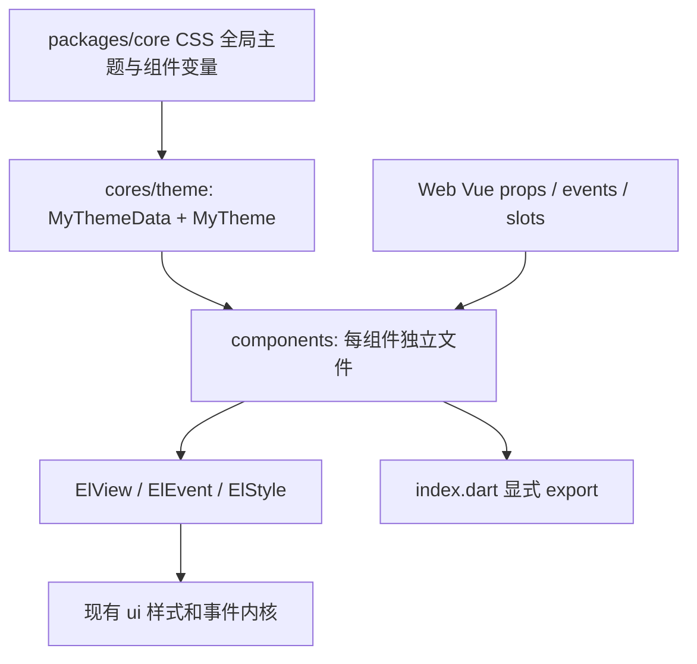

# my-ui Flutter 迁移计划

本计划在生产实现前写入。基准：D:/project/html/my-ui；目标：lib/src/my_ui。先完成阶段1、2，阶段3以后保持未开工。组件总数54，出处 packages/vue/index.ts:6-67。

## 架构与仓库接入

- 与当前 lib/src/ui/components/index.dart:1-33 的独立import/export约定一致；不复用旧包全part私有域，不改lib/ui.dart。受限于只允许写目标目录，统一入口是 `package:flutter_base/src/my_ui/index.dart`，顶层 `lib/my_ui.dart` 留给用户后续授权。
- My前缀符合 .claude/CLAUDE.md:7 的设计语言前缀例外；文件无品牌前缀。公开API均中文注释；每Dart头部指向HTML真源。
- 风格使用实际类型token + ElStyle，明暗由MyTheme和ElThemeMode贯通；覆写CSS组件变量通过MyThemeData同名camelCase字段传入（当前ElStyle构造无vars，lib/src/ui/cores/view/style/style.dart:17-98）。
- 单向值：value为父输入、onChanged为用户变更通知；外部更新不反射事件。可选modelValue ValueNotifier遵循lib/src/ui/components/switch.dart:30-42的互斥约定；Tag null表示纯展示。
- 保留ElEventDetails事件载荷与preventDefault；原生DOM type=submit/reset映射Flutter FormState validate/save/reset，完整Web Form组装留阶段3。
- Flutter逻辑px对应CSS px；字体平台fallback和栅格差异须TODO(parity)标记。禁止窗口测试。

## 阶段1：token / 主题内核

- 全量迁移CSS :root 和 :root[data-theme=dark] 的实际颜色、精确alpha阴影、overlay blur及四档字重，来源 my-ui.css:10-68、82-149。
- 首批组件变量与断点：Button <=400；Card <=1100/760/400；Progress/Divider/Tag/Switch覆写变量有实际消费者。
- DoD：主题所有根token有测试；light/dark/nested override能更新已挂载组件；跟随系统亮暗、reduced-motion、默认文本样式和ElThemeMode一致；不新增依赖。

## 阶段2：八个基础组件

| 次序 | 组件 | 实施重点与DoD |
| --- | --- | --- |
| 1 | Loading | 三档16/24/32，800ms，status与默认插槽；reduced-motion禁动画。 |
| 2 | Button | 七variant、icon、disabled/loading/nullable selected/type、时序；loading保留尺寸/焦点；键鼠与触摸、提交/重置、取消有断言。 |
| 3 | Tag | 展示/受控选择、五tone、change→click、disabled、外层命中不缩；props+slot+顺序测试。 |
| 4 | Switch | value/label/disabled、47×28/22/3/19、白/主文字拇指、仅Space；外部值更新不回调。 |
| 5 | Card | 标题/说明/sample/interactive、完整断点、触摸参数；内部控件不触发整卡；Enter repeat不重复、Space抬起激活。 |
| 6 | Divider | horizontal/vertical、start/center/end、dashed、默认插槽及separator语义；默认竖高13，线宽1与留白变量。 |
| 7 | Progress | max/value/buffer异常归一化、line/circle、四status、读数builder、辅助文案；buffer>=value；空值与非有限值不确定。 |
| 8 | Skeleton | loading/rows/avatar/label，保留child实例且隐藏焦点/语义；三档行数边界、42%/66%与12/18几何（相邻margin折叠已测）。 |

阶段2 DoD：结构性props与事件有Web→Flutter映射表及测试；默认静态几何/颜色/断点均断言；不确定字体/动效/栅格细节旁标TODO(parity)，存在TODO时只能标部分对齐；定向flutter analyze 0 error、warning逐条解释；dart pub get与flutter test test/my_ui通过。

## 阶段3：其余基础、输入与选择

Icon/Avatar/Image/Badge/Empty → Input/Textarea/Form/FormField → Radio/Checkbox及组 → TagGroup/Choices/Select/Combobox/Segmented/Stepper。DoD：逐项API矩阵、真实焦点与IME、disabled/readonly、reset、插槽保留、纯值规则和组件测试；不以系统默认Material控件外观替代原CSS。

## 阶段4：复合容器、导航与值算法

CellGroup/ListRow/Collapse/CollapseItem、Tabs/Navigation/Tabbar/AppBar、Notice/Steps、Slider、Picker/DatePicker/TimePicker/Calendar、PullRefresh。DoD：迁移对应Web纯函数测试；受控更新、键盘、取消、布局/节点保留、滚动交接有无头测试；源码证据与未验收设备项分开。

## 阶段5：浮层、预览与上传

Floating/Tooltip/Menu/Popover、Dialog/Sheet/Drawer/Popup/Toast、ImagePreview、Upload。DoD：异步结果/离场结束、焦点恢复、层级返回、滚动锁、手势取消和迟到结果/对象URL释放；依赖新增须逐条解释；无授权不做真机窗口验证。

## 初始 parity checklist（实施前快照）

每格初始未勾选；最终进度更新在 my-ui-report.md，保留本表作为实施前基线。三列分开，不以测试通过代替视觉验收。

| 组件 | Props 对齐 | 事件对齐 | 视觉对齐 |
| --- | --- | --- | --- |
| Button | [ ] | [ ] | [ ] |
| Tag | [ ] | [ ] | [ ] |
| Switch | [ ] | [ ] | [ ] |
| Card | [ ] | [ ] | [ ] |
| Divider | [ ] | [ ] | [ ] |
| Loading | [ ] | [ ] | [ ] |
| Progress | [ ] | [ ] | [ ] |
| Skeleton | [ ] | [ ] | [ ] |
| Icon | [ ] | [ ] | [ ] |
| Avatar | [ ] | [ ] | [ ] |
| Image | [ ] | [ ] | [ ] |
| ImagePreview | [ ] | [ ] | [ ] |
| Badge | [ ] | [ ] | [ ] |
| TagGroup | [ ] | [ ] | [ ] |
| Input | [ ] | [ ] | [ ] |
| Form | [ ] | [ ] | [ ] |
| FormField | [ ] | [ ] | [ ] |
| Textarea | [ ] | [ ] | [ ] |
| Empty | [ ] | [ ] | [ ] |
| Tooltip | [ ] | [ ] | [ ] |
| PullRefresh | [ ] | [ ] | [ ] |
| CellGroup | [ ] | [ ] | [ ] |
| Tabs | [ ] | [ ] | [ ] |
| Select | [ ] | [ ] | [ ] |
| Combobox | [ ] | [ ] | [ ] |
| Segmented | [ ] | [ ] | [ ] |
| Slider | [ ] | [ ] | [ ] |
| Picker | [ ] | [ ] | [ ] |
| DatePicker | [ ] | [ ] | [ ] |
| TimePicker | [ ] | [ ] | [ ] |
| Calendar | [ ] | [ ] | [ ] |
| Upload | [ ] | [ ] | [ ] |
| AppBar | [ ] | [ ] | [ ] |
| Notice | [ ] | [ ] | [ ] |
| Steps | [ ] | [ ] | [ ] |
| Choices | [ ] | [ ] | [ ] |
| Radio | [ ] | [ ] | [ ] |
| RadioGroup | [ ] | [ ] | [ ] |
| Checkbox | [ ] | [ ] | [ ] |
| CheckboxGroup | [ ] | [ ] | [ ] |
| Collapse | [ ] | [ ] | [ ] |
| CollapseItem | [ ] | [ ] | [ ] |
| Stepper | [ ] | [ ] | [ ] |
| ListRow | [ ] | [ ] | [ ] |
| Navigation | [ ] | [ ] | [ ] |
| Tabbar | [ ] | [ ] | [ ] |
| Popover | [ ] | [ ] | [ ] |
| Floating | [ ] | [ ] | [ ] |
| Menu | [ ] | [ ] | [ ] |
| Dialog | [ ] | [ ] | [ ] |
| Sheet | [ ] | [ ] | [ ] |
| Drawer | [ ] | [ ] | [ ] |
| Popup | [ ] | [ ] | [ ] |
| Toast | [ ] | [ ] | [ ] |

## 验证与范围

- 禁止任何git操作，不commit/push/switch/stash；只写用户白名单；不改ui/scroll或其他lib入口。
- 首选本机Flutter 3.47.5 CLI；SDK缓存若不可写，允许在test/my_ui/.sdk内临时使用隔离缓存的同版本CLI（.codex实际只读，验证后清理）。不得改全局SDK、不跳过共享锁、不使用load_workspace_dependencies。
- 命令仅跑新模块：dart pub get --enforce-lockfile --no-example；flutter analyze lib/src/my_ui test/my_ui --no-pub；flutter test test/my_ui --no-pub --concurrency=1。用户要求flutter analyze时亦执行全仓静态分析；不运行全量测试。
- CLI自动生成的.dart_tool/build视为运行缓存；不得手工修改白名单外源文件或锁文件。若缓存受权限限制无法运行，原样报告exit code/错误，不标通过。

## 暂停/续作

- 每阶段在report记录完成点、下一条命令、阻碍与TODO位置；外部codex exec resume继续同会话，不需要git恢复。
- 续作先读本计划、inventory/audit/report和局部规范，再核对真源是否变化；禁止把旧README或历史记忆作为当前验收证据。
