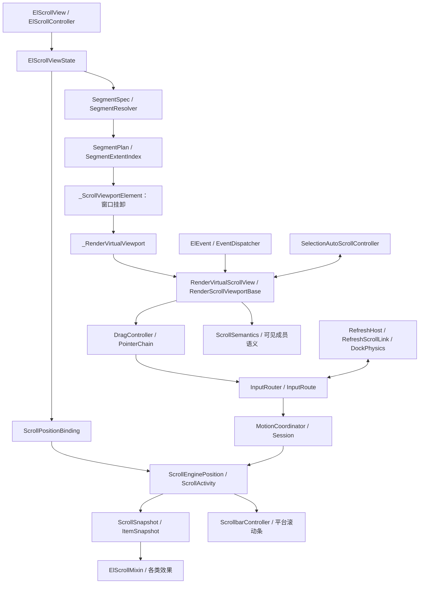

**结论：scroll 已随 el_ui 完整迁入，当前是“自定义视口＋Flutter ScrollPosition/Physics＋统一虚拟化管线”的滚动内核，可以开始有边界的维护。优先项是建立现有契约基线，并处理仍跳过的 5 个滚动相关功能变体。**入口及实现证据：[ui.dart:69](/D:/project/flutter/flutter_base/lib/ui.dart:69)、[scroll_view.dart:35](/D:/project/flutter/flutter_base/lib/src/ui/cores/scroll/scroll_view.dart:35)。

本次只读源码、测试、局部规范及已有提交元数据；没有修改文件，没有执行 git 命令，没有运行 analyze、build 或 test。下文测试结果均注明来自已有迁移报告，不代表本轮重新验证。

## 一、文件清单与职责

以下以 **`S = lib/src/ui/cores/scroll/`** 表示滚动模块目录；表内路径均相对 S，行号指向对应声明或职责说明。

### 1. 滚动模块地图



接线证据：[virtual_pipeline.dart:18](/D:/project/flutter/flutter_base/lib/src/ui/cores/scroll/virtual/virtual_pipeline.dart:18)、[scroll_view_state.dart:849](/D:/project/flutter/flutter_base/lib/src/ui/cores/scroll/virtual/host/scroll_view_state.dart:849)、[scroll_view_state.dart:4373](/D:/project/flutter/flutter_base/lib/src/ui/cores/scroll/virtual/host/scroll_view_state.dart:4373)、[scroll_viewport_base.dart:65](/D:/project/flutter/flutter_base/lib/src/ui/cores/scroll/common/render/scroll_viewport_base.dart:65)。

### 2. 实现文件清单

| 文件 | 一句话职责 |
|---|---|
| [scroll_view.dart:37](/D:/project/flutter/flutter_base/lib/src/ui/cores/scroll/scroll_view.dart:37) | 定义容器参数、索引控制器、可见范围及可见比例模型。 |
| [scroll_state.dart:121](/D:/project/flutter/flutter_base/lib/src/ui/cores/scroll/scroll_state.dart:121) | 定义滚动来源、活动、变化原因、速度来源及不可变快照。 |
| [common/viewport/scroll_position_binding.dart:40](/D:/project/flutter/flutter_base/lib/src/ui/cores/scroll/common/viewport/scroll_position_binding.dart:40) | 实现 ScrollContext，管理 controller/position 创建、重绑、恢复与失活。 |
| [common/viewport/scroll_engine_position.dart:89](/D:/project/flutter/flutter_base/lib/src/ui/cores/scroll/common/viewport/scroll_engine_position.dart:89) | 在官方 position 上加入运动所有权、样本观察和过期写入保护。 |
| [common/viewport/scroll_viewport.dart:19](/D:/project/flutter/flutter_base/lib/src/ui/cores/scroll/common/viewport/scroll_viewport.dart:19) | 定义选区、滚轮信号等消费者使用的视口窄接口。 |
| [common/render/scroll_viewport_base.dart:65](/D:/project/flutter/flutter_base/lib/src/ui/cores/scroll/common/render/scroll_viewport_base.dart:65) | 承担输入、绘制位移、命中、样式继承、显示区域和滚动语义基础能力。 |
| [common/render/scroll_semantics.dart:4](/D:/project/flutter/flutter_base/lib/src/ui/cores/scroll/common/render/scroll_semantics.dart:4) | 将稳定滚动语义边界与内部子项动态变换分离。 |
| [common/pointer/scroll_drag_controller.dart:33](/D:/project/flutter/flutter_base/lib/src/ui/cores/scroll/common/pointer/scroll_drag_controller.dart:33) | 把 El 拖拽、触控板事件转成 hold/drag/fling，并处理边界余量。 |
| [common/pointer/scroll_input_step.dart:6](/D:/project/flutter/flutter_base/lib/src/ui/cores/scroll/common/pointer/scroll_input_step.dart:6) | 将原始输入预算转换为接受输入、实际位移、剩余输入和 overscroll。 |
| [common/pointer/scroll_input_transaction.dart:40](/D:/project/flutter/flutter_base/lib/src/ui/cores/scroll/common/pointer/scroll_input_transaction.dart:40) | 管理同步输入事务、唯一源宿主、writer 和样本结算。 |
| [common/pointer/scroll_pointer_chain.dart:17](/D:/project/flutter/flutter_base/lib/src/ui/cores/scroll/common/pointer/scroll_pointer_chain.dart:17) | 按轴锁定滚轮宿主，并统一提交 pointer-signal resolver 动作。 |
| [common/pointer/scroll_pointer_motion.dart:9](/D:/project/flutter/flutter_base/lib/src/ui/cores/scroll/common/pointer/scroll_pointer_motion.dart:9) | 声明平滑滚轮与受控运动会话之间的接口。 |
| [common/pointer/scroll_touch_event_latch.dart:10](/D:/project/flutter/flutter_base/lib/src/ui/cores/scroll/common/pointer/scroll_touch_event_latch.dart:10) | 在活动指针序列结束前延迟事件接线及结构更新。 |
| [common/pointer/scroll_touch_gate.dart:11](/D:/project/flutter/flutter_base/lib/src/ui/cores/scroll/common/pointer/scroll_touch_gate.dart:11) | 判断直接拖动/触摸惯性，记录只负责接住滚动的指针。 |
| [common/nested/scroll_delta_interceptor.dart:26](/D:/project/flutter/flutter_base/lib/src/ui/cores/scroll/common/nested/scroll_delta_interceptor.dart:26) | 定义 delta 已消费量和释放剩余速度的拦截协议。 |
| [common/nested/nested_scroll.dart:22](/D:/project/flutter/flutter_base/lib/src/ui/cores/scroll/common/nested/nested_scroll.dart:22) | 定义嵌套父级、节点链及 pre/post 消费适配。 |
| [common/physics/platform_scroll_physics.dart:17](/D:/project/flutter/flutter_base/lib/src/ui/cores/scroll/common/physics/platform_scroll_physics.dart:17) | 提供平台默认 physics 和 ElScrollBehavior。 |
| [common/physics/clamping_scroll_physics.dart:18](/D:/project/flutter/flutter_base/lib/src/ui/cores/scroll/common/physics/clamping_scroll_physics.dart:18) | 提供可配置停止速度的 clamping 惯性。 |
| [common/physics/bouncing_scroll_physics.dart:31](/D:/project/flutter/flutter_base/lib/src/ui/cores/scroll/common/physics/bouncing_scroll_physics.dart:31) | 修正越界向内惯性的保留及边缘向外速度限制。 |
| [common/physics/browser_scroll_physics.dart:116](/D:/project/flutter/flutter_base/lib/src/ui/cores/scroll/common/physics/browser_scroll_physics.dart:116) | 实现 spline fling、时长上限和连续 fling boost。 |
| [smooth_scroll/smooth_scroll.dart:32](/D:/project/flutter/flutter_base/lib/src/ui/cores/scroll/smooth_scroll/smooth_scroll.dart:32) | 定义 Windows/Chromium 滚轮步长、时长和曲线策略。 |
| [smooth_scroll/smooth_pointer_scroll.dart:38](/D:/project/flutter/flutter_base/lib/src/ui/cores/scroll/smooth_scroll/smooth_pointer_scroll.dart:38) | 管理目标累积、retarget、Ticker、Activity 和触控板直滚分类。 |
| [spec/segment_spec.dart:105](/D:/project/flutter/flutter_base/lib/src/ui/cores/scroll/spec/segment_spec.dart:105) | 定义静态、列表、网格段以及物化/builder 数据源。 |
| [spec/segment_resolver.dart:9](/D:/project/flutter/flutter_base/lib/src/ui/cores/scroll/spec/segment_resolver.dart:9) | 将 children 中的 LayoutView 解构成段，拒绝 Sliver。 |
| [plan/segment_plan.dart:14](/D:/project/flutter/flutter_base/lib/src/ui/cores/scroll/plan/segment_plan.dart:14) | 统一 item、行、网格列及间距之间的换算。 |
| [plan/segment_extent_index.dart:13](/D:/project/flutter/flutter_base/lib/src/ui/cores/scroll/plan/segment_extent_index.dart:13) | 按段维护尺寸索引，固定段使用算术尺寸。 |
| [plan/segment_diff.dart:7](/D:/project/flutter/flutter_base/lib/src/ui/cores/scroll/plan/segment_diff.dart:7) | 对齐新旧段，将增删/重排转换为尺寸和锚点迁移。 |
| [virtual/virtual_pipeline.dart:1](/D:/project/flutter/flutter_base/lib/src/ui/cores/scroll/virtual/virtual_pipeline.dart:1) | 统一虚拟管线 library，通过 part 共享内部实现。 |
| [virtual/host/scroll_view_state.dart:425](/D:/project/flutter/flutter_base/lib/src/ui/cores/scroll/virtual/host/scroll_view_state.dart:425) | 总宿主，协调 position、窗口、度量、Mixin、索引定位和外围配置。 |
| [virtual/widget/scroll_viewport_widget.dart:6](/D:/project/flutter/flutter_base/lib/src/ui/cores/scroll/virtual/widget/scroll_viewport_widget.dart:6) | 将宿主快照和输入配置传入视口 RenderObject。 |
| [virtual/mount/scroll_mount.dart:248](/D:/project/flutter/flutter_base/lib/src/ui/cores/scroll/virtual/mount/scroll_mount.dart:248) | 实现窗口挂卸、Element 对账、LayoutView 接管和 chrome 挂载。 |
| [virtual/mount/virtual_slot_records.dart:6](/D:/project/flutter/flutter_base/lib/src/ui/cores/scroll/virtual/mount/virtual_slot_records.dart:6) | 保存挂载 slot、范围和重映射记录。 |
| [virtual/item/flat_segment_item_list.dart:11](/D:/project/flutter/flutter_base/lib/src/ui/cores/scroll/virtual/item/flat_segment_item_list.dart:11) | 提供扁平 item 视图及有界 builder 缓存。 |
| [virtual/item/scroll_item_scope.dart:7](/D:/project/flutter/flutter_base/lib/src/ui/cores/scroll/virtual/item/scroll_item_scope.dart:7) | 为已挂载成员提供宿主、index 和稳定身份，不增加 RenderObject。 |
| [virtual/input/scroll_input_router.dart:6](/D:/project/flutter/flutter_base/lib/src/ui/cores/scroll/virtual/input/scroll_input_router.dart:6) | 解析每轴 inputOrder，分发 Mixin pre/post/fling。 |
| [virtual/input/scroll_input_route.dart:4](/D:/project/flutter/flutter_base/lib/src/ui/cores/scroll/virtual/input/scroll_input_route.dart:4) | 管理源宿主与同轴祖先的一次真实输入路线。 |
| [virtual/motion/scroll_motion_coordinator.dart:4](/D:/project/flutter/flutter_base/lib/src/ui/cores/scroll/virtual/motion/scroll_motion_coordinator.dart:4) | 让正文、祖先和有限效果行程共享惯性生产者。 |
| [virtual/motion/scroll_pointer_motion.dart:4](/D:/project/flutter/flutter_base/lib/src/ui/cores/scroll/virtual/motion/scroll_pointer_motion.dart:4) | 将实际滚轮会话接入路线及运动所有权。 |
| [virtual/motion/scroll_session.dart:58](/D:/project/flutter/flutter_base/lib/src/ui/cores/scroll/virtual/motion/scroll_session.dart:58) | 分开管理实际输入终态、异步 settle 和整组运动终态。 |
| [virtual/render/render_virtual_scroll_view.dart:38](/D:/project/flutter/flutter_base/lib/src/ui/cores/scroll/virtual/render/render_virtual_scroll_view.dart:38) | 提供 shrinkWrap、滚动条 inset 收敛及 thumb 分数映射基础。 |
| [virtual/render/render_virtual_viewport.dart:49](/D:/project/flutter/flutter_base/lib/src/ui/cores/scroll/virtual/render/render_virtual_viewport.dart:49) | 实际执行成员布局、测量回报、绘制、命中、sticky 和语义裁剪。 |
| [virtual/virtual_extent_index.dart:52](/D:/project/flutter/flutter_base/lib/src/ui/cores/scroll/virtual/virtual_extent_index.dart:52) | 使用前缀和/Fenwick 索引维护变尺寸行的测量与估计。 |
| [virtual/virtual_scroll_geometry.dart:21](/D:/project/flutter/flutter_base/lib/src/ui/cores/scroll/virtual/virtual_scroll_geometry.dart:21) | 统一贴边、reverse、thumb 分数与内容坐标数学。 |
| [virtual/testing/scroll_debug_counters.dart:10](/D:/project/flutter/flutter_base/lib/src/ui/cores/scroll/virtual/testing/scroll_debug_counters.dart:10) | 提供布局、绘制、挂载等白盒计数。 |
| [virtual/testing/scroll_mixin_client_probe.dart:5](/D:/project/flutter/flutter_base/lib/src/ui/cores/scroll/virtual/testing/scroll_mixin_client_probe.dart:5) | 提供 Mixin 注册与生命周期测试探针。 |
| [effects/scroll_mixin.dart:244](/D:/project/flutter/flutter_base/lib/src/ui/cores/scroll/effects/scroll_mixin.dart:244) | 提供后代 State 的滚动订阅、成员快照和输入协商入口。 |
| [effects/scroll_effect_track.dart:15](/D:/project/flutter/flutter_base/lib/src/ui/cores/scroll/effects/scroll_effect_track.dart:15) | 声明效果身份、有限值域及输入距离换算。 |
| [effects/sticky_mixin.dart:6](/D:/project/flutter/flutter_base/lib/src/ui/cores/scroll/effects/sticky_mixin.dart:6) | 声明 item sticky 所有权及 pinned 状态。 |
| [effects/scroll_collapse_mixin.dart:69](/D:/project/flutter/flutter_base/lib/src/ui/cores/scroll/effects/scroll_collapse_mixin.dart:69) | 实现按方向、实际增量或消费输入驱动的折叠效果。 |
| [effects/scroll_collapse_layout.dart:4](/D:/project/flutter/flutter_base/lib/src/ui/cores/scroll/effects/scroll_collapse_layout.dart:4) | 测量折叠端点并布局展开/折叠内容。 |
| [effects/large_title_navbar_mixin.dart:18](/D:/project/flutter/flutter_base/lib/src/ui/cores/scroll/effects/large_title_navbar_mixin.dart:18) | 管理大标题导航折叠、标题交接及底部槽位。 |
| [effects/large_title_navbar_layout.dart:37](/D:/project/flutter/flutter_base/lib/src/ui/cores/scroll/effects/large_title_navbar_layout.dart:37) | 执行大标题导航的自然尺寸测量与布局。 |
| [effects/scroll_item_effects.dart:4](/D:/project/flutter/flutter_base/lib/src/ui/cores/scroll/effects/scroll_item_effects.dart:4) | 实现 reveal、parallax 和滚动进度效果。 |
| [effects/nested_scroll_mixin.dart:33](/D:/project/flutter/flutter_base/lib/src/ui/cores/scroll/effects/nested_scroll_mixin.dart:33) | 将 State 声明为嵌套消费区域，适配统一输入详情。 |
| [effects/scroll_stretch.dart:16](/D:/project/flutter/flutter_base/lib/src/ui/cores/scroll/effects/scroll_stretch.dart:16) | 将 Android stretch 限定到正文区域并处理禁止指示器通知。 |
| [scrollbar/scrollbar.dart:1](/D:/project/flutter/flutter_base/lib/src/ui/cores/scroll/scrollbar/scrollbar.dart:1) | 汇总滚动条实现导出。 |
| [scrollbar/scrollbar_base.dart:151](/D:/project/flutter/flutter_base/lib/src/ui/cores/scroll/scrollbar/scrollbar_base.dart:151) | 定义滚动条策略、轴详情、轨道/按钮/thumb 组件与交互。 |
| [scrollbar/scrollbar_controller.dart:21](/D:/project/flutter/flutter_base/lib/src/ui/cores/scroll/scrollbar/scrollbar_controller.dart:21) | 将真实 position 转换成轴详情并接收滚动条操作。 |
| [scrollbar/window_scroll_bar.dart:8](/D:/project/flutter/flutter_base/lib/src/ui/cores/scroll/scrollbar/window_scroll_bar.dart:8) | 实现 Windows inset 条带、箭头和 hover/drag 外观。 |
| [scrollbar/mac_scroll_bar.dart:9](/D:/project/flutter/flutter_base/lib/src/ui/cores/scroll/scrollbar/mac_scroll_bar.dart:9) | 实现 macOS 浮动条带策略与外观。 |
| [scrollbar/ios_scroll_bar.dart:9](/D:/project/flutter/flutter_base/lib/src/ui/cores/scroll/scrollbar/ios_scroll_bar.dart:9) | 实现 iOS thumb、按压和拖动策略。 |
| [scrollbar/android_scroll_bar.dart:10](/D:/project/flutter/flutter_base/lib/src/ui/cores/scroll/scrollbar/android_scroll_bar.dart:10) | 实现 Android 滚动条外观和主题颜色解析。 |
| [refresh/refresh.dart:1](/D:/project/flutter/flutter_base/lib/src/ui/cores/scroll/refresh/refresh.dart:1) | 汇总刷新器、刷新状态及 spinner 导出。 |
| [refresh/refresher.dart:107](/D:/project/flutter/flutter_base/lib/src/ui/cores/scroll/refresh/refresher.dart:107) | 定义刷新配置、快照、details、内容与指示器组合协议。 |
| [refresh/refresh_host.dart:33](/D:/project/flutter/flutter_base/lib/src/ui/cores/scroll/refresh/refresh_host.dart:33) | 管理拉出消费、刷新状态机、异步回调和停靠物理。 |
| [refresh/android_refresher.dart:44](/D:/project/flutter/flutter_base/lib/src/ui/cores/scroll/refresh/android_refresher.dart:44) | 实现悬浮圆盘式刷新及 Material spinner。 |
| [refresh/ios_refresher.dart:50](/D:/project/flutter/flutter_base/lib/src/ui/cores/scroll/refresh/ios_refresher.dart:50) | 实现内容让位式刷新及 Cupertino spinner。 |

### 3. 模块外的直接边界

| 路径 | 与 scroll 的关系 |
|---|---|
| [lib/ui.dart:69](/D:/project/flutter/flutter_base/lib/ui.dart:69) | 业务公开入口，显式导出滚动、效果、physics、滚动条和刷新 API。 |
| [layout/layout_view.dart:30](/D:/project/flutter/flutter_base/lib/src/ui/cores/layout/layout_view.dart:30)、[list/list_view.dart:6](/D:/project/flutter/flutter_base/lib/src/ui/cores/layout/list/list_view.dart:6)、[grid/grid_view.dart:6](/D:/project/flutter/flutter_base/lib/src/ui/cores/layout/grid/grid_view.dart:6) | 提供段声明和实际 Element/Render 子项接管协议。 |
| [layout/geometry/extent_index.dart:2](/D:/project/flutter/flutter_base/lib/src/ui/cores/layout/geometry/extent_index.dart:2)、[list_geometry.dart:5](/D:/project/flutter/flutter_base/lib/src/ui/cores/layout/geometry/list_geometry.dart:5)、[grid_geometry.dart:8](/D:/project/flutter/flutter_base/lib/src/ui/cores/layout/geometry/grid_geometry.dart:8)、[axis_geometry.dart:4](/D:/project/flutter/flutter_base/lib/src/ui/cores/layout/geometry/axis_geometry.dart:4)、[pixel_grid.dart:23](/D:/project/flutter/flutter_base/lib/src/ui/cores/layout/geometry/pixel_grid.dart:23) | 共享尺寸查询、列表/网格几何、方向和物理像素对齐。 |
| [view/provider.dart:46](/D:/project/flutter/flutter_base/lib/src/ui/cores/view/provider.dart:46) | 提供滚动条、刷新器及平滑滚轮环境默认值。 |
| [selection/common/selection_auto_scroll.dart:133](/D:/project/flutter/flutter_base/lib/src/ui/cores/selection/common/selection_auto_scroll.dart:133) | 选区拖动和句柄拖动的自动滚动消费者。 |
| [selection/docs/selection_model.dart:4](/D:/project/flutter/flutter_base/lib/src/ui/cores/selection/docs/selection_model.dart:4)、[selection_render.dart:410](/D:/project/flutter/flutter_base/lib/src/ui/cores/selection/docs/selection_render.dart:410) | 决定窗口回收后的选区范围及选择/滚动手势竞争。 |
| [editable/editable_view.dart:5908](/D:/project/flutter/flutter_base/lib/src/ui/cores/editable/editable_view.dart:5908)、[table/table_view.dart:1037](/D:/project/flutter/flutter_base/lib/src/ui/cores/table/table_view.dart:1037) | 编辑器和表格直接使用滚动容器及索引定位能力。 |
| [image/image_view.dart:208](/D:/project/flutter/flutter_base/lib/src/ui/cores/image/image_view.dart:208) | 通过 ElScrollMixin 获得图片解码可见性和优先级。 |
| [widgets/dnd/drag_session.dart:199](/D:/project/flutter/flutter_base/lib/src/ui/widgets/dnd/drag_session.dart:199) | 拖放自动滚动复用 RenderScrollViewportBase。 |
| [view/render/scroll_cursor_freeze.dart:15](/D:/project/flutter/flutter_base/lib/src/ui/cores/view/render/scroll_cursor_freeze.dart:15) | 滚动期间冻结后代鼠标命中/光标更新。 |
| [lib/src/flutter/widgets/infinite_scroll.dart:17](/D:/project/flutter/flutter_base/lib/src/flutter/widgets/infinite_scroll.dart:17)、[mixins/notify.dart:4](/D:/project/flutter/flutter_base/lib/src/flutter/mixins/notify.dart:4) | 另有基于标准 controller/notification 的无限加载和触边监听工具。 |
| [lib/src/flutter/extensions/flutter.dart:449](/D:/project/flutter/flutter_base/lib/src/flutter/extensions/flutter.dart:449) | 保留查找官方 ScrollableState 的水平滚轮辅助方法。 |

## 二、核心类与方法签名

下面保留关键声明原文，省略实现体。需要区分：`ui.dart` 导出的业务 API、`@protected` 扩展钩子，以及内部接线类。

### 1. ElScrollView：容器声明面

类声明是：

```dart
class ElScrollView extends StatefulWidget
```

构造参数原文如下；完整断言位于构造函数之后。[scroll_view.dart:37](/D:/project/flutter/flutter_base/lib/src/ui/cores/scroll/scroll_view.dart:37)、[scroll_view.dart:76](/D:/project/flutter/flutter_base/lib/src/ui/cores/scroll/scroll_view.dart:76)。

```dart
const ElScrollView({
  super.key,
  required this.children,
  this.controller,
  this.horizontalController,
  this.physics,
  this.smoothScroll,
  this.mouseWheelHorizontalModifiers = defaultMouseWheelHorizontalModifiers,
  this.scrollbar,
  this.axis = Axis.vertical,
  this.reverse = false,
  this.shrinkWrap = false,
  this.pinToEnd = false,
  this.preserveAnchor = false,
  this.clipBehavior = Clip.hardEdge,
  this.padding = EdgeInsets.zero,
  this.gap = 0.0,
  this.crossAxisAlignment,
  this.minimumCrossAxisExtentListenable,
  this.itemExtentInvalidationListenable,
  this.excludeSemantics = false,
  this.semanticsRole,
  this.keyboardDismissBehavior = ScrollViewKeyboardDismissBehavior.manual,
  this.focusNode,
  this.keyboardScroll = true,
  this.dragStartDistance,
  this.cacheExtent = 250.0,
  this.onVisibleRangeChanged,
  this.dragOptimize,
  this.event,
  this.deltaInterceptor,
  this.inputOrder = const {},
  this.refresher,
  this.onRefresh,
  this.refreshEdge = ElRefreshEdge.leading,
})
```

关键公开成员类型：

| 类别 | 原声明及证据 |
|---|---|
| 内容与输入顺序 | `final List<Widget> children;`、`final Map<Axis, List<Object>> inputOrder;`。[125–133 行起](/D:/project/flutter/flutter_base/lib/src/ui/cores/scroll/scroll_view.dart:125) |
| 控制器 | `final ScrollController? controller;`、`final ScrollController? horizontalController;`。[135 行](/D:/project/flutter/flutter_base/lib/src/ui/cores/scroll/scroll_view.dart:135) |
| 行为策略 | `final ScrollPhysics? physics;`、`final ElSmoothScroll? smoothScroll;`、`final ElScrollbar? scrollbar;`。[143 行](/D:/project/flutter/flutter_base/lib/src/ui/cores/scroll/scroll_view.dart:143) |
| 方向与布局 | `final Axis? axis;`、`final bool shrinkWrap;`、`final bool reverse;`、`final bool pinToEnd;`、`final bool preserveAnchor;`。[167 行](/D:/project/flutter/flutter_base/lib/src/ui/cores/scroll/scroll_view.dart:167) |
| 几何 | `final Clip clipBehavior;`、`final EdgeInsets padding;`、`final double gap;`、`final CrossAxisAlignment? crossAxisAlignment;`。[198 行](/D:/project/flutter/flutter_base/lib/src/ui/cores/scroll/scroll_view.dart:198) |
| 语义与键盘 | `final bool excludeSemantics;`、`final SemanticsRole? semanticsRole;`、`final ScrollViewKeyboardDismissBehavior keyboardDismissBehavior;`、`final FocusNode? focusNode;`、`final bool keyboardScroll;`。[228 行](/D:/project/flutter/flutter_base/lib/src/ui/cores/scroll/scroll_view.dart:228) |
| 窗口与输入 | `final double? dragStartDistance;`、`final double cacheExtent;`、`final ValueChanged<ElVisibleRange>? onVisibleRangeChanged;`、`final bool? dragOptimize;`、`final ElEvent? event;`、`final ElScrollDeltaInterceptor? deltaInterceptor;`。[246 行](/D:/project/flutter/flutter_base/lib/src/ui/cores/scroll/scroll_view.dart:246) |
| 刷新 | `final ElRefresher? refresher;`、`final Future<void> Function()? onRefresh;`、`final ElRefreshEdge refreshEdge;`。[269 行](/D:/project/flutter/flutter_base/lib/src/ui/cores/scroll/scroll_view.dart:269) |

宿主查找与 State 工厂：

```dart
static ElScrollViewState? maybeOf(BuildContext context, {Axis? axis})
static ElScrollViewState of(BuildContext context, {Axis? axis})
ElScrollViewState createState() => ElScrollViewState();
```

证据分别为 [scroll_view.dart:49](/D:/project/flutter/flutter_base/lib/src/ui/cores/scroll/scroll_view.dart:49)、[56](/D:/project/flutter/flutter_base/lib/src/ui/cores/scroll/scroll_view.dart:56)、[279](/D:/project/flutter/flutter_base/lib/src/ui/cores/scroll/scroll_view.dart:279)。

### 2. ElScrollController：像素控制之外的索引定位

它继承标准 `ScrollController`，新增能力包括滚轮转发、索引定位结果和取消；attach 明确禁止多 position，包括 release。[scroll_view.dart:312](/D:/project/flutter/flutter_base/lib/src/ui/cores/scroll/scroll_view.dart:312)。

```dart
ElScrollController({
  super.initialScrollOffset,
  super.keepScrollOffset,
  super.debugLabel,
  super.onAttach,
  super.onDetach,
})

void attach(ScrollPosition position)

ScrollPosition createScrollPosition(
  ScrollPhysics physics,
  ScrollContext context,
  ScrollPosition? oldPosition,
)

bool dispatchPointerScroll(PointerScrollEvent event)

Future<void> scrollToIndex(int index, {double alignment = 0.0, Duration? duration, Curve curve = Curves.easeInOut})

Future<bool> scrollToIndexWithResult(
  int index, {
  double alignment = 0.0,
  Duration? duration,
  Curve curve = Curves.easeInOut,
})

bool cancelScrollToIndex() => _bridge?.cancelScrollToIndex() ?? false;
```

其中 `createScrollPosition` 在源码中为单行参数声明，返回 `ScrollEnginePosition`；位置：[313](/D:/project/flutter/flutter_base/lib/src/ui/cores/scroll/scroll_view.dart:313)、[325](/D:/project/flutter/flutter_base/lib/src/ui/cores/scroll/scroll_view.dart:325)、[332](/D:/project/flutter/flutter_base/lib/src/ui/cores/scroll/scroll_view.dart:332)、[343](/D:/project/flutter/flutter_base/lib/src/ui/cores/scroll/scroll_view.dart:343)、[376](/D:/project/flutter/flutter_base/lib/src/ui/cores/scroll/scroll_view.dart:376)、[386](/D:/project/flutter/flutter_base/lib/src/ui/cores/scroll/scroll_view.dart:386)、[405](/D:/project/flutter/flutter_base/lib/src/ui/cores/scroll/scroll_view.dart:405)。

另有语法上公开、文档明确“内部使用”的接线成员：

```dart
void attachIndexBridge(ScrollIndexBridge bridge)
void detachIndexBridge(ScrollIndexBridge bridge)
```

不能因为它们是 public 就把它们作为业务入口。[scroll_view.dart:349](/D:/project/flutter/flutter_base/lib/src/ui/cores/scroll/scroll_view.dart:349)。

**结果语义很关键：**`scrollToIndexWithResult` 的 true 表示已收敛，false 包含取消、结构换代、解绑及达到迭代上限；`scrollToIndex` 会丢弃这个 bool。[scroll_view.dart:376](/D:/project/flutter/flutter_base/lib/src/ui/cores/scroll/scroll_view.dart:376)、[380](/D:/project/flutter/flutter_base/lib/src/ui/cores/scroll/scroll_view.dart:380)。

### 3. ElScrollViewState：实际宿主能力

```dart
final class ElScrollViewState extends State<ElScrollView> with TickerProviderStateMixin implements ScrollIndexBridge
```

主要公开读取面：

```dart
ScrollController get controller => _scrollBinding.controller;
ScrollPosition get position => _scrollBinding.position;
ScrollController? get horizontalController => _horizontalBinding?.controller;
ScrollPosition? get horizontalPosition => _horizontalBinding?.position;
Axis? get axis => _appliedAxis;
AxisDirection get axisDirection => _scrollBinding.axisDirection;
bool get reverse => _appliedReverse;
bool get hasContentDimensions => position.hasPixels && position.hasContentDimensions;
ScrollMetrics? get metrics => hasContentDimensions ? position : null;

ScrollPosition? positionFor(Axis axis)
ScrollMetrics? metricsFor(Axis axis)
```

证据：[scroll_view_state.dart:425](/D:/project/flutter/flutter_base/lib/src/ui/cores/scroll/virtual/host/scroll_view_state.dart:425)、[695](/D:/project/flutter/flutter_base/lib/src/ui/cores/scroll/virtual/host/scroll_view_state.dart:695)。

其实现的命令接口：

```dart
bool dispatchPointerScroll(PointerScrollEvent event)

Future<bool> jumpToIndex(int index, {required double alignment})

Future<bool> animateToIndex(
  int index, {
  required double alignment,
  required Duration duration,
  required Curve curve,
})

bool cancelScrollToIndex() => _cancelScrollToIndexOperation();
```

证据：[448](/D:/project/flutter/flutter_base/lib/src/ui/cores/scroll/virtual/host/scroll_view_state.dart:448)、[3562](/D:/project/flutter/flutter_base/lib/src/ui/cores/scroll/virtual/host/scroll_view_state.dart:3562)、[3717](/D:/project/flutter/flutter_base/lib/src/ui/cores/scroll/virtual/host/scroll_view_state.dart:3717)、[3615](/D:/project/flutter/flutter_base/lib/src/ui/cores/scroll/virtual/host/scroll_view_state.dart:3615)。

### 4. ElScrollMixin：观察与消费扩展面

```dart
mixin ElScrollMixin<T extends StatefulWidget> on State<T> implements _ScrollMixinClient
```

读取能力包括：

```dart
bool get hasScrollView => _scrollView != null;
bool get hasScrollItem => _scrollItemScope != null;
int? get scrollItemIndex => _scrollItemScope?.index;
ElScrollItemSnapshot get scrollItemSnapshot => _scrollItemSnapshot;
ElScrollViewState? get scrollView => _scrollView;

ScrollController? get scrollController
ScrollPosition? get scrollPosition
ScrollMetrics? get scrollMetrics
ElScrollSnapshot get scrollSnapshot

ElScrollViewState get requireScrollView
ScrollController get requireScrollController
ScrollPosition get requireScrollPosition
ScrollMetrics get requireScrollMetrics
```

证据：[scroll_mixin.dart:244](/D:/project/flutter/flutter_base/lib/src/ui/cores/scroll/effects/scroll_mixin.dart:244)、[332](/D:/project/flutter/flutter_base/lib/src/ui/cores/scroll/effects/scroll_mixin.dart:332)、[360](/D:/project/flutter/flutter_base/lib/src/ui/cores/scroll/effects/scroll_mixin.dart:360)。

控制订阅、成员能力和输入参与的 protected getter：

```dart
Axis? get requestedScrollAxis => null;
bool get observesScrollUpdates => scrollEffectGlobalObservation ?? true;
bool get observesScrollMetrics => scrollEffectGlobalObservation ?? true;
bool get observesScrollSessions => scrollEffectGlobalObservation ?? true;
bool get listenScrollItem => false;
bool get observesScrollItemUpdates => false;
bool get observesScrollItemSize => false;
bool get scrollItemPreserveAnchor => true;
bool get scrollItemViewportHeader => false;
bool get trackScrollItemVisibility => false;
bool get trackScrollItemVisibleFraction => false;
double? get scrollItemStickyOffset => null;
Object? get scrollInputSlot => null;
Iterable<ElScrollEffectTrack> get scrollEffectTracks => const [];
bool get rebuildOnScrollUpdate => false;
```

证据：[scroll_mixin.dart:258](/D:/project/flutter/flutter_base/lib/src/ui/cores/scroll/effects/scroll_mixin.dart:258)。

生命周期及输入钩子：

```dart
void onScrollViewAttached(ElScrollViewState scrollView) {}
void onScrollViewDetached(ElScrollViewState scrollView) {}
void onScrollStart(ElScrollStartDetails details) {}
void onScrollUpdate(ElScrollUpdateDetails details) {}
void onScrollEnd(ElScrollEndDetails details) {}
void onScrollMetricsChanged(ElScrollMetricsDetails details) {}
void onScrollActivityChanged(ElScrollActivityDetails details) {}
void onScrollItemUpdate(ElScrollItemUpdateDetails details) {}
void onScrollItemVisibilityChanged(ElVisibilityInfo info) {}

void onInputStart(ElScrollSessionDetails details) {}
void onInputEnd(ElScrollSessionDetails details) {}
void onInputCancel(ElScrollSessionDetails details) {}
Future<void>? onScrollSettle(ElScrollSessionDetails details) => null;
bool isScrollMotionCurrent(ElScrollSessionDetails details)
void onMotionSettled(ElScrollSessionDetails details) {}
void onMotionCancelled(ElScrollSessionDetails details) {}

double onPreScroll(ElScrollInputDetails input, double remaining) => remaining;
double onPostScroll(ElScrollInputDetails input, double remaining) => remaining;
double onPreFling(ElScrollReleaseDetails details, double remainingVelocity) => remainingVelocity;
```

其中输入/终态等钩子标记了 `@mustCallSuper`。**这些消费钩子返回剩余量。**证据：[scroll_mixin.dart:617](/D:/project/flutter/flutter_base/lib/src/ui/cores/scroll/effects/scroll_mixin.dart:617)、[664](/D:/project/flutter/flutter_base/lib/src/ui/cores/scroll/effects/scroll_mixin.dart:664)。

### 5. 状态模型与事件详情

`ElScrollSnapshot` 的公开状态不是一个 offset：

| 状态组 | 公开成员 |
|---|---|
| 有效性及坐标身份 | `attached`、`hasMetrics`、`axis`、`axisDirection`、`bindingGeneration`、`layoutRevision`、`sampleId`、`sessionId`、`timeStamp`、`reverse` |
| 位移与校正 | `contentOffset`、`rawPixels`、`motionDelta`、`rawContentOffset`、`correctionDelta`、`coordinateReset` |
| 运动描述 | `cause`、`velocitySource`、`velocity`、`direction`、`activity` |
| 范围及越界 | `viewportExtent`、`minScrollExtent`、`maxScrollExtent`、`leadingOverscroll`、`trailingOverscroll`、`atStart`、`atEnd` |

字段类型和构造要求见 [scroll_state.dart:123](/D:/project/flutter/flutter_base/lib/src/ui/cores/scroll/scroll_state.dart:123)、[186](/D:/project/flutter/flutter_base/lib/src/ui/cores/scroll/scroll_state.dart:186)。特别是 `final double? velocity;`，未知速度允许为 null。

`ElScrollItemSnapshot` 提供 `index`、`layoutSize`、`itemExtent`、`viewportExtent`、`leadingOffset`、`trailingOffset`、`visibleExtent`、`visibleFraction`、`viewProgress`、`isVisible`、`isMounted`、`isSticky`、`isPinned` 和 `attached`。[scroll_state.dart:347](/D:/project/flutter/flutter_base/lib/src/ui/cores/scroll/scroll_state.dart:347)。

详情模型分工：

- `ElScrollDetails` 保存实时 `scrollView/position`，以及历史 `previousSnapshot/snapshot`；start/update/end 共用这组字段。[scroll_mixin.dart:11](/D:/project/flutter/flutter_base/lib/src/ui/cores/scroll/effects/scroll_mixin.dart:11)
- `ElScrollMetricsDetails.metrics` 是派发时冻结的指标；布局未就绪时为 null。[scroll_mixin.dart:74](/D:/project/flutter/flutter_base/lib/src/ui/cores/scroll/effects/scroll_mixin.dart:74)
- `ElScrollInputDetails` 区分 `rawDelta` 和内容坐标下的 `requestedDelta`，并携带 transaction/session/sample 身份。[scroll_mixin.dart:120](/D:/project/flutter/flutter_base/lib/src/ui/cores/scroll/effects/scroll_mixin.dart:120)
- `ElScrollReleaseDetails` 区分 `rawVelocity` 和标准化 `releaseVelocity`。[scroll_mixin.dart:180](/D:/project/flutter/flutter_base/lib/src/ui/cores/scroll/effects/scroll_mixin.dart:180)
- `ElScrollSessionDetails` 另外保存 `motionId`、`bindingGeneration`、源宿主和释放速度。[scroll_session.dart:5](/D:/project/flutter/flutter_base/lib/src/ui/cores/scroll/virtual/motion/scroll_session.dart:5)

### 6. Physics、嵌套与平滑策略

关键公开签名：

```dart
ScrollPhysics elScrollPhysicsFor(TargetPlatform platform)

class ElScrollBehavior extends ScrollBehavior
ScrollPhysics getScrollPhysics(BuildContext context)

class ElClampingScrollPhysics extends ClampingScrollPhysics
const ElClampingScrollPhysics({this.stopVelocity = 10, super.parent})
final double stopVelocity;
ElClampingScrollPhysics applyTo(ScrollPhysics? ancestor)
Tolerance toleranceFor(ScrollMetrics metrics)
Simulation? createBallisticSimulation(ScrollMetrics position, double velocity)

class ElBouncingScrollPhysics extends BouncingScrollPhysics
const ElBouncingScrollPhysics({super.decelerationRate, super.parent})
bool carriesInwardMomentum(ScrollMetrics position, double velocity)

abstract class ElSmoothScroll
double stepForEvent(double rawDelta, int burstTicks);
Duration segmentDuration(double delta, double velocity);
Curve curveFor(double initialSlope);
```

证据：[platform_scroll_physics.dart:17](/D:/project/flutter/flutter_base/lib/src/ui/cores/scroll/common/physics/platform_scroll_physics.dart:17)、[clamping_scroll_physics.dart:18](/D:/project/flutter/flutter_base/lib/src/ui/cores/scroll/common/physics/clamping_scroll_physics.dart:18)、[bouncing_scroll_physics.dart:31](/D:/project/flutter/flutter_base/lib/src/ui/cores/scroll/common/physics/bouncing_scroll_physics.dart:31)、[smooth_scroll.dart:32](/D:/project/flutter/flutter_base/lib/src/ui/cores/scroll/smooth_scroll/smooth_scroll.dart:32)。

`ElBrowserScrollPhysics` 另公开 friction、maxFlingDuration、boostFactor、boostMinVelocity 等配置，并实现 `ElFlingBoostSpec` 的速度合成及指定时刻速度查询。[browser_scroll_physics.dart:41](/D:/project/flutter/flutter_base/lib/src/ui/cores/scroll/common/physics/browser_scroll_physics.dart:41)、[116](/D:/project/flutter/flutter_base/lib/src/ui/cores/scroll/common/physics/browser_scroll_physics.dart:116)。

低层拦截协议原文：

```dart
double interceptScrollDelta(double delta, ElScrollDeltaSource source);
double interceptFlingVelocity(double velocity) => velocity;
double interceptPostScroll(double delta, ElScrollDeltaSource source);
```

这里 delta 返回**已消费量**，fling 返回**剩余速度**，与 Mixin 的 delta 返回约定不同。[scroll_delta_interceptor.dart:26](/D:/project/flutter/flutter_base/lib/src/ui/cores/scroll/common/nested/scroll_delta_interceptor.dart:26)。

`ElNestedScrollParent` 的主要公开成员：

```dart
Axis? get nestedScrollAxis => null;
void onNestedScrollStart(Axis axis, ElScrollDeltaSource source) {}
double onNestedPreScroll(double delta, ElScrollDeltaSource source) => 0.0;
double onNestedPostScroll(double unconsumed, ElScrollDeltaSource source) => 0.0;
double onNestedPreFling(double velocity) => velocity;
void onNestedScrollEnd() {}
```

证据：[nested_scroll.dart:22](/D:/project/flutter/flutter_base/lib/src/ui/cores/scroll/common/nested/nested_scroll.dart:22)。

### 7. 滚动条与刷新公开协议

`ElScrollbarAxisDetails` 公开轴方向、范围、pixels、viewportExtent、滚动状态、逻辑/视觉分数及以下命令：

```dart
double fractionForPixels(double pixels);
double pixelsForFraction(double fraction);
void scrollByLine({required bool forward});
void scrollByPage({required bool forward});
void scrollByPixels(double delta);
void jumpToPixels(double pixels);
Future<void> animateToPixels(double pixels, {required Duration duration, Curve curve = Curves.easeOut});
void jumpToFraction(double fraction);
void beginThumbDrag();
void updateThumbDrag(double fraction);
void endThumbDrag();
void cancelInteraction();
```

`ElScrollbarDetails` 是可监听的轴详情集合：

```dart
ElScrollbarAxisDetails? operator [](Axis axis);
bool dispatchPointerSignal(PointerSignalEvent event);
```

证据：[scrollbar_base.dart:64](/D:/project/flutter/flutter_base/lib/src/ui/cores/scroll/scrollbar/scrollbar_base.dart:64)、[142](/D:/project/flutter/flutter_base/lib/src/ui/cores/scroll/scrollbar/scrollbar_base.dart:142)。

`ElScrollbar` 的构建边界包括 `buildChildren`、`buildThumb`、`buildTrack`、`buildAxisBackground`、前后按钮和 corner；另外通过 resolve 系列方法控制方向、inset、厚度、交互、淡出和按钮重复。默认 `int get zIndex => 10;`。[scrollbar_base.dart:151](/D:/project/flutter/flutter_base/lib/src/ui/cores/scroll/scrollbar/scrollbar_base.dart:151)、[282](/D:/project/flutter/flutter_base/lib/src/ui/cores/scroll/scrollbar/scrollbar_base.dart:282)、[355](/D:/project/flutter/flutter_base/lib/src/ui/cores/scroll/scrollbar/scrollbar_base.dart:355)。

`ElRefreshDetails` 的关键签名：

```dart
ValueListenable<ElRefreshSnapshot> get snapshot;
Listenable get repaint;
ScrollPhysics get physics;
double? get contentGap;
Rect? get contentViewportRect => null;
Listenable? get contentLayoutChanges => null;
void requestRefresh();
```

`ElRefresher` 的核心参数和构建边界：

```dart
const ElRefresher({this.movesContent = true});
final bool movesContent;
double get triggerExtent;
double get refreshingExtent;
double? get maxPullExtent => triggerExtent * 2.5;
SpringDescription? get settleSpring => elWebKitRubberBandSpring;
bool behindContent(ElRefreshDetails details) => movesContent;
bool get hapticOnTrigger => false;
Widget buildIndicator(BuildContext context, ElRefreshDetails details);
Widget build(BuildContext context, ElRefreshDetails details, Widget child)
```

其余公开 getter 控制 settle/finish 的时长、延迟和曲线。[refresher.dart:78](/D:/project/flutter/flutter_base/lib/src/ui/cores/scroll/refresh/refresher.dart:78)、[107](/D:/project/flutter/flutter_base/lib/src/ui/cores/scroll/refresh/refresher.dart:107)。

## 三、数据与状态流

### 1. 声明、段计划、挂载和测量形成闭环

`ElScrollView.children` 中，普通 Widget 成为 `StaticSegment`；直接出现的 `ElListView/ElGridView` 通过 LayoutView 协议变成 Linear/Grid 段。分隔项计入扁平索引，网格一个“尺寸行”对应多个 item；SliverMultiBoxAdaptorWidget 会被显式拒绝。[segment_resolver.dart:9](/D:/project/flutter/flutter_base/lib/src/ui/cores/scroll/spec/segment_resolver.dart:9)、[27](/D:/project/flutter/flutter_base/lib/src/ui/cores/scroll/spec/segment_resolver.dart:27)、[segment_plan.dart:182](/D:/project/flutter/flutter_base/lib/src/ui/cores/scroll/plan/segment_plan.dart:182)。

宿主据此建立 `SegmentPlan → FlatSegmentItemList → SegmentExtentIndex`。窗口变化只要求挂载对账时，宿主提交内容快照；真实子项布局再报告实测高度，更新前缀模型、范围与锚点。因此窗口、滚动条和定位使用的是当前同步模型。[scroll_view_state.dart:891](/D:/project/flutter/flutter_base/lib/src/ui/cores/scroll/virtual/host/scroll_view_state.dart:891)、[2857](/D:/project/flutter/flutter_base/lib/src/ui/cores/scroll/virtual/host/scroll_view_state.dart:2857)、[virtual_extent_index.dart:35](/D:/project/flutter/flutter_base/lib/src/ui/cores/scroll/virtual/virtual_extent_index.dart:35)。

这里存在三种不同范围：**已挂载窗口、绘制窗口、语义窗口**。cacheExtent 内的预挂载项只参与布局/测量；拖柄期间语义窗口还会按真实 position 计算，避免直接沿用 thumb 的视觉窗口。[scroll_view.dart:249](/D:/project/flutter/flutter_base/lib/src/ui/cores/scroll/scroll_view.dart:249)、[scroll_view_state.dart:2939](/D:/project/flutter/flutter_base/lib/src/ui/cores/scroll/virtual/host/scroll_view_state.dart:2939)。

### 2. Position 是像素状态源，Binding 负责其有效期

默认 controller 和 ElScrollController 都创建 `ScrollEnginePosition`；外部 controller 则通过自身工厂创建 position。Binding 将其 attach 到 controller，同时提供方向、DPR、vsync、notificationContext 和 PageStorage 通道。[scroll_position_binding.dart:11](/D:/project/flutter/flutter_base/lib/src/ui/cores/scroll/common/viewport/scroll_position_binding.dart:11)、[263](/D:/project/flutter/flutter_base/lib/src/ui/cores/scroll/common/viewport/scroll_position_binding.dart:263)、[284](/D:/project/flutter/flutter_base/lib/src/ui/cores/scroll/common/viewport/scroll_position_binding.dart:284)。

controller、physics、轴、reverse 等变化可能替换 position；DPR 或 ScrollConfiguration 变化也触发重建判断。旧 position 先退休运动、detach，再延迟 dispose。[scroll_position_binding.dart:162](/D:/project/flutter/flutter_base/lib/src/ui/cores/scroll/common/viewport/scroll_position_binding.dart:162)、[176](/D:/project/flutter/flutter_base/lib/src/ui/cores/scroll/common/viewport/scroll_position_binding.dart:176)、[263](/D:/project/flutter/flutter_base/lib/src/ui/cores/scroll/common/viewport/scroll_position_binding.dart:263)。

失活与销毁不是同一件事：deactivate 禁止 context 通知、退休运动并 detach；activate 可以重新 attach 保留的 position。宿主同时取消定位、停止路线和观察回调。[scroll_position_binding.dart:213](/D:/project/flutter/flutter_base/lib/src/ui/cores/scroll/common/viewport/scroll_position_binding.dart:213)、[scroll_view_state.dart:1236](/D:/project/flutter/flutter_base/lib/src/ui/cores/scroll/virtual/host/scroll_view_state.dart:1236)。

### 3. ElEvent 先执行用户回调，再决定默认滚动

视口直接持有 `EventDispatcher(this)`，将用户 ElEvent 与默认滚动回调组合。拖拽、PanZoom、PointerSignal 都走这条路径；没有额外用官方 ScrollableState 承担输入宿主。[scroll_viewport_base.dart:533](/D:/project/flutter/flutter_base/lib/src/ui/cores/scroll/common/render/scroll_viewport_base.dart:533)、[557](/D:/project/flutter/flutter_base/lib/src/ui/cores/scroll/common/render/scroll_viewport_base.dart:557)、[scroll_view_state.dart:4452](/D:/project/flutter/flutter_base/lib/src/ui/cores/scroll/virtual/host/scroll_view_state.dart:4452)。

用户回调可以 `preventDefault`；drag/PanZoom 的禁止状态会延续到本次序列后续阶段，并取消已有拖动。**DragEnd/DragCancel 仍执行默认终态清理**，不能简单因 defaultPrevented 提前返回。[scroll_viewport_base.dart:688](/D:/project/flutter/flutter_base/lib/src/ui/cores/scroll/common/render/scroll_viewport_base.dart:688)、[734](/D:/project/flutter/flutter_base/lib/src/ui/cores/scroll/common/render/scroll_viewport_base.dart:734)。

### 4. 输入预算与实际位移分开结算

直接拖拽先捕获轴、方向和 physics 快照，再经过拦截器、`ScrollInputStep` 和边界交接。`ScrollInputStep` 同时返回：

- `acceptedInput`：接受了多少原始输入；
- `appliedDisplacement`：阻尼后移动了多少；
- `remainingInput`：还可交给其他消费者的输入；
- `overscroll`：边界拒绝的位移。

阻尼非线性时，代码通过反求接受输入来避免把位移直接当作输入余量。[scroll_drag_controller.dart:454](/D:/project/flutter/flutter_base/lib/src/ui/cores/scroll/common/pointer/scroll_drag_controller.dart:454)、[scroll_input_step.dart:6](/D:/project/flutter/flutter_base/lib/src/ui/cores/scroll/common/pointer/scroll_input_step.dart:6)、[58](/D:/project/flutter/flutter_base/lib/src/ui/cores/scroll/common/pointer/scroll_input_step.dart:58)。

Mixin 输入顺序由 `inputOrder` 明确声明：pre 正序，post 反序；缺少多参与者排序、重复 slot 都会报错。跨宿主路线则先处理祖先 pre，再处理正文及祖先 post；不能用 zIndex 或挂载顺序替代它。[scroll_input_router.dart:48](/D:/project/flutter/flutter_base/lib/src/ui/cores/scroll/virtual/input/scroll_input_router.dart:48)、[115](/D:/project/flutter/flutter_base/lib/src/ui/cores/scroll/virtual/input/scroll_input_router.dart:115)、[289](/D:/project/flutter/flutter_base/lib/src/ui/cores/scroll/virtual/input/scroll_input_router.dart:289)、[scroll_input_route.dart:310](/D:/project/flutter/flutter_base/lib/src/ui/cores/scroll/virtual/input/scroll_input_route.dart:310)。

### 5. Velocity 至少有三个层次，不能混成一个值

第一层是事件释放速度：DragEnd 从 `ElEventDetails.velocity` 取值，经过拦截、boost，再启动真实惯性。[scroll_drag_controller.dart:710](/D:/project/flutter/flutter_base/lib/src/ui/cores/scroll/common/pointer/scroll_drag_controller.dart:710)。

第二层是 simulation 的瞬时速度：MotionCoordinator 对统一行程采样 `simulation.x/time` 与 `simulation.dx/time`，把每帧 delta 分配给效果、正文和祖先；范围或布局变化时会 rebase。[scroll_motion_coordinator.dart:227](/D:/project/flutter/flutter_base/lib/src/ui/cores/scroll/virtual/motion/scroll_motion_coordinator.dart:227)。

第三层是公开 snapshot 速度：当前实现优先使用受控样本的帧估算；没有可比样本时允许 null，空闲时可为 0。虽然枚举含 tracker/simulation，当前 snapshot 构建分支实际设置的是 frameEstimate、stationary 或 unknown。[scroll_engine_position.dart:249](/D:/project/flutter/flutter_base/lib/src/ui/cores/scroll/common/viewport/scroll_engine_position.dart:249)、[scroll_view_state.dart:1898](/D:/project/flutter/flutter_base/lib/src/ui/cores/scroll/virtual/host/scroll_view_state.dart:1898)。

### 6. Offset 快照明确剥离布局校正

宿主将 raw pixels 换成视觉内容坐标，再计算：

```text
offsetDelta = 新 contentOffset - 旧 contentOffset
motionDelta = offsetDelta - correctionDelta
```

`contentOffset` 被钳在内容范围内；`rawContentOffset` 保留越界，leading/trailingOverscroll 从它派生。绑定代、方向或关键范围变化时设置 coordinateReset，避免跨坐标系差分。[scroll_view_state.dart:1833](/D:/project/flutter/flutter_base/lib/src/ui/cores/scroll/virtual/host/scroll_view_state.dart:1833)。

测量、保位和范围回钳会记录 layoutCorrection；受控 drag/惯性期间的校正尽量保留活动，而不是统一 jumpTo 中断运动。[scroll_view_state.dart:3905](/D:/project/flutter/flutter_base/lib/src/ui/cores/scroll/virtual/host/scroll_view_state.dart:3905)、[scroll_engine_position.dart:378](/D:/project/flutter/flutter_base/lib/src/ui/cores/scroll/common/viewport/scroll_engine_position.dart:378)。

### 7. 运动所有权与输入生命周期各有身份

`ScrollMotionOwner` 通过对象身份和 bindingGeneration 判断是否仍有效；旧 owner 的 setPixels、drag、animate 等写入受到保护。事务禁止同步重入，同一个 position 不能登记两个 writer。[scroll_engine_position.dart:84](/D:/project/flutter/flutter_base/lib/src/ui/cores/scroll/common/viewport/scroll_engine_position.dart:84)、[228](/D:/project/flutter/flutter_base/lib/src/ui/cores/scroll/common/viewport/scroll_engine_position.dart:228)、[scroll_input_transaction.dart:71](/D:/project/flutter/flutter_base/lib/src/ui/cores/scroll/common/pointer/scroll_input_transaction.dart:71)、[118](/D:/project/flutter/flutter_base/lib/src/ui/cores/scroll/common/pointer/scroll_input_transaction.dart:118)。

**inputEnd 不等于 motionSettled。**输入结束后还可能有惯性，以及各 Mixin 返回的异步 settle；整组完成后才发送 motionSettled，取消则走独立终态。[scroll_session.dart:108](/D:/project/flutter/flutter_base/lib/src/ui/cores/scroll/virtual/motion/scroll_session.dart:108)、[197](/D:/project/flutter/flutter_base/lib/src/ui/cores/scroll/virtual/motion/scroll_session.dart:197)。

### 8. 滚轮和平滑链与直接触摸不同

普通 mouse PointerScrollEvent 在桌面非 macOS 下，会根据 `20.0` 的 delta 阈值及 `80ms` 会话窗口判断是否直滚；平滑滚轮另有 `90ms` burst 和 `150ms` settle grace。它是代码中的分类策略，真实设备识别准确度本轮待验证。[smooth_pointer_scroll.dart:16](/D:/project/flutter/flutter_base/lib/src/ui/cores/scroll/smooth_scroll/smooth_pointer_scroll.dart:16)、[175](/D:/project/flutter/flutter_base/lib/src/ui/cores/scroll/smooth_scroll/smooth_pointer_scroll.dart:175)。

PointerChain 按轴批量登记 resolver 动作，优先深层宿主，每轴处理一次，并最终决定是否允许平台默认动作。ElEvent 的 remainingDelta 同时参与部分消费后的上行传播。[scroll_pointer_chain.dart:215](/D:/project/flutter/flutter_base/lib/src/ui/cores/scroll/common/pointer/scroll_pointer_chain.dart:215)、[scroll_viewport_base.dart:1663](/D:/project/flutter/flutter_base/lib/src/ui/cores/scroll/common/render/scroll_viewport_base.dart:1663)。

### 9. 滚动条既观察 position，也会反向接管运动

ScrollbarController 监听 pixels 和 isScrolling；布局期通知会合并到 post-frame。thumb 开始时 hold position，并冻结拖动范围；虚拟主轴使用专门 delegate，将视觉 fraction 映射到当前尺寸模型。[scrollbar_controller.dart:94](/D:/project/flutter/flutter_base/lib/src/ui/cores/scroll/scrollbar/scrollbar_controller.dart:94)、[286](/D:/project/flutter/flutter_base/lib/src/ui/cores/scroll/scrollbar/scrollbar_controller.dart:286)、[scroll_view_state.dart:4646](/D:/project/flutter/flutter_base/lib/src/ui/cores/scroll/virtual/host/scroll_view_state.dart:4646)。

thumb 的 fraction、真实 pixels、挂载窗口是不同状态；拖动期间保留一行保护带，防止跨输入/布局阶段出现短暂空白。拖动结束的贴边修正也不等同于业务 pinToEnd。[scroll_view_state.dart:632](/D:/project/flutter/flutter_base/lib/src/ui/cores/scroll/virtual/host/scroll_view_state.dart:632)、[747](/D:/project/flutter/flutter_base/lib/src/ui/cores/scroll/virtual/host/scroll_view_state.dart:747)、[scroll_view.dart:180](/D:/project/flutter/flutter_base/lib/src/ui/cores/scroll/scroll_view.dart:180)。

### 10. 刷新从输入预算接入，再临时改变边界物理

Android 悬浮刷新主要消费手指行程，内容保持在边界；iOS 式刷新让内容露出间隙，并通过 RefreshDockPhysics 外扩停靠边界。两者都在松手时触发刷新，armed 后拉回阈值内再释放不应触发。[refresh_host.dart:113](/D:/project/flutter/flutter_base/lib/src/ui/cores/scroll/refresh/refresh_host.dart:113)、[210](/D:/project/flutter/flutter_base/lib/src/ui/cores/scroll/refresh/refresh_host.dart:210)、[537](/D:/project/flutter/flutter_base/lib/src/ui/cores/scroll/refresh/refresh_host.dart:537)。

状态依次涉及 null、drag、armed、refresh、done 或 canceled；onRefresh 完成后根据停靠间隙和当前惯性决定返回方式，完成回调有 mounted 检查。[refresher.dart:34](/D:/project/flutter/flutter_base/lib/src/ui/cores/scroll/refresh/refresher.dart:34)、[refresh_host.dart:601](/D:/project/flutter/flutter_base/lib/src/ui/cores/scroll/refresh/refresh_host.dart:601)、[645](/D:/project/flutter/flutter_base/lib/src/ui/cores/scroll/refresh/refresh_host.dart:645)。

### 11. Selection 通过视口协议形成双向同步

选区控制器从参考参与者和锚点向上收集 ScrollViewport，订阅其 scrollOffsetListenable；滚动后失效选区几何并同步范围。自动滚动按实际时间差积分，调用视口 `applySelectionAutoScrollDelta`；视口会先取消平滑滚轮再更新 position。[selection_auto_scroll.dart:192](/D:/project/flutter/flutter_base/lib/src/ui/cores/selection/common/selection_auto_scroll.dart:192)、[254](/D:/project/flutter/flutter_base/lib/src/ui/cores/selection/common/selection_auto_scroll.dart:254)、[264](/D:/project/flutter/flutter_base/lib/src/ui/cores/selection/common/selection_auto_scroll.dart:264)、[scroll_viewport_base.dart:822](/D:/project/flutter/flutter_base/lib/src/ui/cores/scroll/common/render/scroll_viewport_base.dart:822)。

全选是**当前挂载成员的快照**。窗口回收后保留仍有效的旧参与者，新挂载行不继承历史全选；拖选两个存活端点之间插入内容则保持范围连续，这两种行为有意不同。[selection_model.dart:9](/D:/project/flutter/flutter_base/lib/src/ui/cores/selection/docs/selection_model.dart:9)、[99](/D:/project/flutter/flutter_base/lib/src/ui/cores/selection/docs/selection_model.dart:99)、[selected_virtual_scroll_test.dart:67](/D:/project/flutter/flutter_base/test/ui/cores/selection/selected_virtual_scroll_test.dart:67)。

### 12. Semantics 和 ElView 变体影响不同层面

ScrollSemantics 从真实 position 提交范围和滚动动作；内部视口只提交当前呈现的候选子项，滚动后更新语义变换。绘制层序、语义遍历和文档选择顺序不能合并成一个排序规则。[scroll_semantics.dart:12](/D:/project/flutter/flutter_base/lib/src/ui/cores/scroll/common/render/scroll_semantics.dart:12)、[scroll_viewport_base.dart:1894](/D:/project/flutter/flutter_base/lib/src/ui/cores/scroll/common/render/scroll_viewport_base.dart:1894)、[render_virtual_viewport.dart:2267](/D:/project/flutter/flutter_base/lib/src/ui/cores/scroll/virtual/render/render_virtual_viewport.dart:2267)、[selection_model.dart:36](/D:/project/flutter/flutter_base/lib/src/ui/cores/selection/docs/selection_model.dart:36)。

迁入的 ElView 事件/变体会直接影响滚动条 hover/drag/dark 外观，以及焦点键盘入口；基础视口自身也实现 InheritableNode，继续向子树传递样式、dark 和 responsive 信息。它们并未替代 position 的像素状态。[window_scroll_bar.dart:170](/D:/project/flutter/flutter_base/lib/src/ui/cores/scroll/scrollbar/window_scroll_bar.dart:170)、[scroll_view_state.dart:4528](/D:/project/flutter/flutter_base/lib/src/ui/cores/scroll/virtual/host/scroll_view_state.dart:4528)、[scroll_viewport_base.dart:836](/D:/project/flutter/flutter_base/lib/src/ui/cores/scroll/common/render/scroll_viewport_base.dart:836)。

## 四、与迁移的耦合点

### 1. 提交链与具体影响

提交身份通过已有 HEAD reflog 核验；恢复提交同时只读比对了前后对象内容。

| 提交 | 与本次分析的关系 |
|---|---|
| `1a3a5fd` 搬运 view/event/selection 内核 | 引入目前 scroll 所依赖的事件和选区基础。[.git/logs/HEAD:59](/D:/project/flutter/flutter_base/.git/logs/HEAD:59) |
| `dc656b1` list_tile 适配 | 当前条目使用 `ElEvent(onTap: ...)` 和 `ElStyle.onHover/onTap`；这是 API 迁入痕迹，不能据此认定 scroll 已单独验收。[HEAD:60](/D:/project/flutter/flutter_base/.git/logs/HEAD:60)、[list_tile/index.dart:27](/D:/project/flutter/flutter_base/lib/src/ui/components/list_tile/index.dart:27) |
| `8479e85` 全量迁移 el_ui | 当前 scroll 的公共导出与内部实现均已存在。[HEAD:61](/D:/project/flutter/flutter_base/.git/logs/HEAD:61)、[ui.dart:69](/D:/project/flutter/flutter_base/lib/ui.dart:69) |
| `bdb47b8` 修复迁移测试 | 第一轮修正 Chromium 滚轮倍率，并记录遗留失败。[HEAD:62](/D:/project/flutter/flutter_base/.git/logs/HEAD:62)、[迁移报告:28](/D:/project/flutter/flutter_base/.claude/plan/test-migration-report.md:28) |
| `e191fe6` 恢复 48 项并修复回归 | 直接改动 scroll 宿主、selection、dispatcher/press/transform，以及 scroll 测试。[HEAD:63](/D:/project/flutter/flutter_base/.git/logs/HEAD:63) |
| `a47ee1f` 提交迁移测试 | 保存完整迁移测试集。[HEAD:64](/D:/project/flutter/flutter_base/.git/logs/HEAD:64) |

`e191fe6` 中最值得保留的滚动相关改动：

- **网格拖柄扩窗使用段内真实行距**：从统一 `_gap` 改为固定段的 `plan.spacingAfterRow(firstRowForExtent)`，避免额外挂一整行。[scroll_view_state.dart:3268](/D:/project/flutter/flutter_base/lib/src/ui/cores/scroll/virtual/host/scroll_view_state.dart:3268)
- **滚轮部分消费后继续交给外层**：dispatcher 只在 defaultPrevented 或余量归零时拦截平台默认，恢复 Preview→外层 Scroll 的余量通道。[dispatcher.dart:379](/D:/project/flutter/flutter_base/lib/src/ui/cores/view/event/dispatcher.dart:379)、[迁移报告:141](/D:/project/flutter/flutter_base/.claude/plan/test-migration-report.md:141)
- **空白长按拒绝后保留滚动竞争**：选择根拒绝选择时同时 preventDefault，避免长按默认认领吞掉后续滚动。[selection_render.dart:410](/D:/project/flutter/flutter_base/lib/src/ui/cores/selection/docs/selection_render.dart:410)
- **全选不回放给新窗口**：清除代理历史端点并阻止全选向新增 selectable 延伸。[selection_model.dart:9](/D:/project/flutter/flutter_base/lib/src/ui/cores/selection/docs/selection_model.dart:9)
- **句柄/工具条复用页面或 dialog chrome 宿主**，避免留在滚动裁剪/变换子树内。[selection_view.dart:287](/D:/project/flutter/flutter_base/lib/src/ui/cores/selection/docs/selection_view.dart:287)、[迁移报告:139](/D:/project/flutter/flutter_base/.claude/plan/test-migration-report.md:139)

### 2. 测试地图和剩余 skip

模块测试职责已写在 [test/ui/cores/scroll/README.md:7](/D:/project/flutter/flutter_base/test/ui/cores/scroll/README.md:7)：core、controller、layout、render、input、nested、physics、virtual、scrollbar、refresh、effects、selection。

此外还有独立的 clamping、content_resize、refresh_physics、measured_initial_window、drag_owner_unmount、session_observer_unmount、unmount_metrics_notification 和 large_title_reattach 测试，覆盖停止阈值、冷启动、卸载和重挂边界；例如 [clamping_physics_test.dart:17](/D:/project/flutter/flutter_base/test/ui/cores/scroll/clamping_physics_test.dart:17)、[measured_initial_window_test.dart:18](/D:/project/flutter/flutter_base/test/ui/cores/scroll/measured_initial_window_test.dart:18)、[session_observer_unmount_test.dart:29](/D:/project/flutter/flutter_base/test/ui/cores/scroll/session_observer_unmount_test.dart:29)、[unmount_metrics_notification_test.dart:29](/D:/project/flutter/flutter_base/test/ui/cores/scroll/unmount_metrics_notification_test.dart:29)。

**当前仍固定跳过、且直接关联 scroll 的功能变体：**

| 数量 | 用例 | 当前证据 |
|---|---|---|
| 4 | 菜单与正文独立滚动的 Windows 语义命中，`fixed=false/true × DPR=1.0/1.75` | 同一注册点保留 `skip: true`；应命中 menu-row-3，报告记录仍命中 page-row-0。[scroll_test.dart:277](/D:/project/flutter/flutter_base/test/ui/semantics/scroll_test.dart:277)、[360](/D:/project/flutter/flutter_base/test/ui/semantics/scroll_test.dart:360) |
| 1 | 三层嵌套 ElTabView→纵向 Scroll→横向 Scroll 的触摸交接 | 明确 TODO；纵向 scroll 应消费拖动，tab index 保持 0。[el_tab_view_test.dart:652](/D:/project/flutter/flutter_base/test/ui/cores/tab_view/el_tab_view_test.dart:652) |

scroll 自身另有按桌面/macOS 条件跳过的滚轮分类、链锁和曲线用例，它们不是统一无条件 skip。[input_test.dart:4110](/D:/project/flutter/flutter_base/test/ui/cores/scroll/input_test.dart:4110)、[nested_test.dart:1901](/D:/project/flutter/flutter_base/test/ui/cores/scroll/nested_test.dart:1901)、[physics_test.dart:103](/D:/project/flutter/flutter_base/test/ui/cores/scroll/physics_test.dart:103)。

迁移报告第二轮记录为 **4,993 通过、9 跳过、0 失败**；9 项由上述 5 项加 4 项 Web 专用测试组成。这是历史记录，本轮没有复跑。[迁移报告:125](/D:/project/flutter/flutter_base/.claude/plan/test-migration-report.md:125)。

## 五、风险与坑

### 1. 已知缺陷：Portal 语义外壳排序仍挡住菜单命中

当前 4 个失败变体覆盖 DPR 1.0 和 1.75，所以不能把问题简单归因于 175% 缩放。报告判断面板与行矩形正确，问题在 OverlayPortal 的语义外壳相对正文的顺序；给面板自身 sortKey 无法越过外壳。[scroll_test.dart:277](/D:/project/flutter/flutter_base/test/ui/semantics/scroll_test.dart:277)、[迁移报告:159](/D:/project/flutter/flutter_base/.claude/plan/test-migration-report.md:159)。

证据边界：当前测试的 Windows 命中是对已提交语义树按遍历顺序递归的**无头模拟检查**，本轮没有 Windows 读屏真机验证。[semantics/common.dart:138](/D:/project/flutter/flutter_base/test/ui/semantics/common.dart:138)。

### 2. 已知缺口：三层 tab/scroll 交接未完成

现有 skip 直接表明该结构的指针序列交接尚未实现；不能用普通两层嵌套或滚动条不带动 tab 的测试替代它。[el_tab_view_test.dart:607](/D:/project/flutter/flutter_base/test/ui/cores/tab_view/el_tab_view_test.dart:607)、[652](/D:/project/flutter/flutter_base/test/ui/cores/tab_view/el_tab_view_test.dart:652)。

后续事件层变更需要保留“取消先于副作用、第二指能接回冻结路线”的已有约束；这些正是恢复提交修过的路径。[transform.dart:744](/D:/project/flutter/flutter_base/lib/src/ui/cores/view/event/transform.dart:744)、[迁移报告:141](/D:/project/flutter/flutter_base/.claude/plan/test-migration-report.md:141)。

### 3. 返回“已消费量”和“剩余量”的 API 容易接反

低层 `ElScrollDeltaInterceptor`、`ElNestedScrollParent` 的 delta 返回已消费量；ElScrollMixin 的 pre/post 返回剩余量。输入源还有不同符号适配，router 负责统一。[scroll_delta_interceptor.dart:26](/D:/project/flutter/flutter_base/lib/src/ui/cores/scroll/common/nested/scroll_delta_interceptor.dart:26)、[nested_scroll.dart:37](/D:/project/flutter/flutter_base/lib/src/ui/cores/scroll/common/nested/nested_scroll.dart:37)、[scroll_mixin.dart:703](/D:/project/flutter/flutter_base/lib/src/ui/cores/scroll/effects/scroll_mixin.dart:703)、[scroll_input_router.dart:366](/D:/project/flutter/flutter_base/lib/src/ui/cores/scroll/virtual/input/scroll_input_router.dart:366)。

把这几层收成同名回调之前，应先固定符号和返回值矩阵；否则可能出现反向移动、重复消费或边界余量消失。

### 4. 官方 ScrollController 兼容性有明确层级

普通像素滚动允许官方 controller；但 deltaInterceptor、效果 tracks 和跨宿主协同会检查 position 是否为 ScrollEnginePosition，部分组合直接抛 FlutterError。[scroll_view.dart:305](/D:/project/flutter/flutter_base/lib/src/ui/cores/scroll/scroll_view.dart:305)、[scroll_view_state.dart:1322](/D:/project/flutter/flutter_base/lib/src/ui/cores/scroll/virtual/host/scroll_view_state.dart:1322)、[1996](/D:/project/flutter/flutter_base/lib/src/ui/cores/scroll/virtual/host/scroll_view_state.dart:1996)、[2102](/D:/project/flutter/flutter_base/lib/src/ui/cores/scroll/virtual/host/scroll_view_state.dart:2102)。

因此 API 保留 `ScrollController?` 类型，不等于所有 controller 子类都支持全部能力；这应成为公开能力说明和定向测试的一部分。

### 5. 布局变化不能当作用户运动

内容测量、窗口 resize、锚点保位都可能改变 pixels。若重构后直接用 `pixels - previousPixels` 驱动折叠、方向或速度，会把 correctionDelta 误算为 motionDelta。[scroll_view_state.dart:1861](/D:/project/flutter/flutter_base/lib/src/ui/cores/scroll/virtual/host/scroll_view_state.dart:1861)、[3905](/D:/project/flutter/flutter_base/lib/src/ui/cores/scroll/virtual/host/scroll_view_state.dart:3905)。

同样，velocity 为 null 表示未知，不能直接当作 0；否则阈值效果会获得错误的“已停止”判断。[scroll_view_state.dart:1898](/D:/project/flutter/flutter_base/lib/src/ui/cores/scroll/virtual/host/scroll_view_state.dart:1898)。

### 6. 热更新和局部 reconcile 可能破坏正在进行的指针序列

现有实现特意在活动指针结束前延迟结构接线；局部虚拟窗口 reconcile 也禁止把初次 build 的 canDrag/ignorePointer 写回真实 activity。[scroll_viewport_base.dart:488](/D:/project/flutter/flutter_base/lib/src/ui/cores/scroll/common/render/scroll_viewport_base.dart:488)、[scroll_touch_event_latch.dart:94](/D:/project/flutter/flutter_base/lib/src/ui/cores/scroll/common/pointer/scroll_touch_event_latch.dart:94)、[scroll_viewport_widget.dart:124](/D:/project/flutter/flutter_base/lib/src/ui/cores/scroll/virtual/widget/scroll_viewport_widget.dart:124)。

这不是可以直接删除的冗余同步。已有“最后一个观察者离屏不能取消拖动”和“首按项卸载”测试，对后续拆分有直接保护价值。[session_observer_unmount_test.dart:29](/D:/project/flutter/flutter_base/test/ui/cores/scroll/session_observer_unmount_test.dart:29)、[drag_owner_unmount_probe_test.dart:8](/D:/project/flutter/flutter_base/test/ui/cores/scroll/drag_owner_unmount_probe_test.dart:8)。

### 7. 全选、保活和窗口回收不能互相替代

当前全选不会为了保存历史选区而保活整份列表，也不会续接新窗口；测试检查旧节点剩余文本及挂载数量。[selected_virtual_scroll_test.dart:67](/D:/project/flutter/flutter_base/test/ui/cores/selection/selected_virtual_scroll_test.dart:67)。

如果调整 keepAlive、builder memo 或选择注册，必须同时检查“旧范围随卸载缩小”和“新窗口仍可重新全选”，避免恢复迁移前已经修掉的全选回放问题。[selection_model.dart:9](/D:/project/flutter/flutter_base/lib/src/ui/cores/selection/docs/selection_model.dart:9)、[selected_virtual_scroll_test.dart:81](/D:/project/flutter/flutter_base/test/ui/cores/selection/selected_virtual_scroll_test.dart:81)。

### 8. DPR 对齐应作用于行占位，滚动位移要保留亚像素

当前变尺寸行先按自然约束 layout，再把返回的**占位 extent**向物理像素网格 ceil；不会机械地把每个业务 RenderBox 拉成取整后的高度。固定尺寸行则使用 tight 约束。[render_virtual_viewport.dart:697](/D:/project/flutter/flutter_base/lib/src/ui/cores/scroll/virtual/render/render_virtual_viewport.dart:697)、[719](/D:/project/flutter/flutter_base/lib/src/ui/cores/scroll/virtual/render/render_virtual_viewport.dart:719)。

源码注释记录过 Windows 物理像素合成导致选区深线的历史经验，但不能把它视为本轮真机复现。当前可确认的保护是五档 DPR 自然高度测试，以及滚动 transform 保留亚像素的实现/测试。[pixel_grid.dart:3](/D:/project/flutter/flutter_base/lib/src/ui/cores/layout/geometry/pixel_grid.dart:3)、[render_test.dart:559](/D:/project/flutter/flutter_base/test/ui/cores/scroll/render_test.dart:559)、[1770](/D:/project/flutter/flutter_base/test/ui/cores/scroll/render_test.dart:1770)。

### 9. shrinkWrap 会关闭虚拟挂窗收益

shrinkWrap 强制全部成员挂载和实测；它保留段声明，但不再按可见窗口挂卸。不能把它当作单纯“尺寸自适应”开关用于超大列表。[scroll_view.dart:170](/D:/project/flutter/flutter_base/lib/src/ui/cores/scroll/scroll_view.dart:170)、[scroll_view_state.dart:2895](/D:/project/flutter/flutter_base/lib/src/ui/cores/scroll/virtual/host/scroll_view_state.dart:2895)。

builder View 也必须直接位于 ElScrollView.children；中间加普通布局包装会失去对应 LayoutViewSlot，并明确报错。[layout_view.dart:144](/D:/project/flutter/flutter_base/lib/src/ui/cores/layout/layout_view.dart:144)。

### 10. 索引定位是有限收敛，Future 完成不等于一定成功

当前最多 10 轮、0.5 容差；达到上限会返回 false。新命令、用户接管、结构换代和卸载都可以取消旧定位。[scroll_view_state.dart:3530](/D:/project/flutter/flutter_base/lib/src/ui/cores/scroll/virtual/host/scroll_view_state.dart:3530)、[3677](/D:/project/flutter/flutter_base/lib/src/ui/cores/scroll/virtual/host/scroll_view_state.dart:3677)。

兼容门面 `Future<void> scrollToIndex` 丢弃完成结果；需要可靠定位结果的消费者应核对 bool 门面使用情况。现有测试已覆盖失败上限、latest-wins 和卸载结清。[controller_test.dart:449](/D:/project/flutter/flutter_base/test/ui/cores/scroll/controller_test.dart:449)、[476](/D:/project/flutter/flutter_base/test/ui/cores/scroll/controller_test.dart:476)、[544](/D:/project/flutter/flutter_base/test/ui/cores/scroll/controller_test.dart:544)。

### 11. 环境默认值来自不同通道

physics 的实际优先级是 widget 参数、显式祖先 ScrollConfiguration、El 平台回落；scrollbar/refresher/smoothScroll 则从 ElViewProvider 解析。MaterialApp 内层的行为可能覆盖外层 ScrollConfiguration。[scroll_view_state.dart:489](/D:/project/flutter/flutter_base/lib/src/ui/cores/scroll/virtual/host/scroll_view_state.dart:489)、[1086](/D:/project/flutter/flutter_base/lib/src/ui/cores/scroll/virtual/host/scroll_view_state.dart:1086)、[core_test.dart:21](/D:/project/flutter/flutter_base/test/ui/cores/scroll/core_test.dart:21)。

例如 Windows/Linux 的 El physics 回落为 bouncing，但 Windows 滚动条默认是 inset 风格；两者不是同一个平台策略对象。[platform_scroll_physics.dart:17](/D:/project/flutter/flutter_base/lib/src/ui/cores/scroll/common/physics/platform_scroll_physics.dart:17)、[provider.dart:46](/D:/project/flutter/flutter_base/lib/src/ui/cores/view/provider.dart:46)。

### 12. 官方 Scrollable 辅助方法不能直接视为通用适配

`.elHorizontalScroll` 查找的是后代 `ScrollableState`，而 ElScrollView 自己组装自定义视口。两者直接组合的兼容性**待验证**，不能仅凭“都有 ScrollController”判断可用。[flutter/extensions/flutter.dart:462](/D:/project/flutter/flutter_base/lib/src/flutter/extensions/flutter.dart:462)、[scroll_view_state.dart:4452](/D:/project/flutter/flutter_base/lib/src/ui/cores/scroll/virtual/host/scroll_view_state.dart:4452)。

### 13. reverse/RTL 的语义动作方向仍应补明确矩阵

语义动作设置主要按 Axis 分支；键盘滚动则显式考虑 axisDirection 是否反向。现有语义动作测试展示的是普通纵向滚动，**reverse/RTL 下动作方向是否符合预期待验证**。[scroll_viewport_base.dart:1878](/D:/project/flutter/flutter_base/lib/src/ui/cores/scroll/common/render/scroll_viewport_base.dart:1878)、[1894](/D:/project/flutter/flutter_base/lib/src/ui/cores/scroll/common/render/scroll_viewport_base.dart:1894)、[semantics/scroll_test.dart:220](/D:/project/flutter/flutter_base/test/ui/semantics/scroll_test.dart:220)。

### 14. 文档有迁移残留，不能直接当实施依据

测试 README 仍给出 `packages/el_ui/test/cores/scroll` 命令；controller 注释还说“无虚拟段时未挂载”，但宿主 attachIndexBridge 没有该条件。后者纯静态容器的实际行为应通过定向测试确认，再统一文档。[scroll/README.md:24](/D:/project/flutter/flutter_base/test/ui/cores/scroll/README.md:24)、[scroll_view.dart:309](/D:/project/flutter/flutter_base/lib/src/ui/cores/scroll/scroll_view.dart:309)、[scroll_view_state.dart:922](/D:/project/flutter/flutter_base/lib/src/ui/cores/scroll/virtual/host/scroll_view_state.dart:922)。

## 六、待办与建议

以下难度为基于当前依赖面的实施估计；本轮未执行这些工作。

| 顺序 | 建议 | 影响面 | 难度估计 | 是否先补测试 |
|---|---|---|---|---|
| 1 | 将当前 5 个滚动相关遗留变体列为独立基线，先明确恢复条件 | Portal 语义、Tab/Scroll 输入交接 | 高 | 已有失败用例；先保留并定向运行原断言。[语义:277](/D:/project/flutter/flutter_base/test/ui/semantics/scroll_test.dart:277)、[Tab:652](/D:/project/flutter/flutter_base/test/ui/cores/tab_view/el_tab_view_test.dart:652) |
| 2 | 固定 controller/position 能力矩阵，以及 consumed/remaining、坐标和终态契约 | controller、input、nested、effects | 中 | 先补未明确覆盖的组合，复用现有 core/controller/nested 测试；能力限制见 [state:1322](/D:/project/flutter/flutter_base/lib/src/ui/cores/scroll/virtual/host/scroll_view_state.dart:1322)、[1996](/D:/project/flutter/flutter_base/lib/src/ui/cores/scroll/virtual/host/scroll_view_state.dart:1996)。 |
| 3 | 补 reverse/RTL 语义动作、纯静态索引定位和官方辅助方法兼容探针 | semantics、公开 API、Flutter 工具扩展 | 中 | 要，先验证待确认行为。[viewport:1894](/D:/project/flutter/flutter_base/lib/src/ui/cores/scroll/common/render/scroll_viewport_base.dart:1894)、[bridge:922](/D:/project/flutter/flutter_base/lib/src/ui/cores/scroll/virtual/host/scroll_view_state.dart:922)、[extension:465](/D:/project/flutter/flutter_base/lib/src/flutter/extensions/flutter.dart:465) |
| 4 | 若本轮目标是简化架构，先围绕宿主的“窗口/度量”“输入/运动”“观察分发”划清责任，再分阶段调整 | 4,000 多行宿主及其 part 文件 | 高 | 先锁住对应测试子集；现有职责集中证据见 [state:2790](/D:/project/flutter/flutter_base/lib/src/ui/cores/scroll/virtual/host/scroll_view_state.dart:2790)、[3534](/D:/project/flutter/flutter_base/lib/src/ui/cores/scroll/virtual/host/scroll_view_state.dart:3534)、[4373](/D:/project/flutter/flutter_base/lib/src/ui/cores/scroll/virtual/host/scroll_view_state.dart:4373)。 |
| 5 | 单独维护滚动条/刷新组合，保留同步尺寸模型、拖柄保护带和刷新停靠语义 | scrollbar、refresh、虚拟窗口 | 中高 | 优先使用已有网格拖柄、inset、refresh_physics 和生命周期测试。[scrollbar_test:249](/D:/project/flutter/flutter_base/test/ui/cores/scroll/scrollbar_test.dart:249)、[364](/D:/project/flutter/flutter_base/test/ui/cores/scroll/scrollbar_test.dart:364)、[scroll_reparent_test:218](/D:/project/flutter/flutter_base/test/ui/lifecycle/scroll_reparent_test.dart:218) |
| 6 | 最后清理 README 路径、旧双容器措辞和索引控制器注释 | 文档、业务入口说明 | 低 | 文档本身无需新测试；行为差异先按第 3 项确认。[README:24](/D:/project/flutter/flutter_base/test/ui/cores/scroll/README.md:24)、[scroll_view:302](/D:/project/flutter/flutter_base/lib/src/ui/cores/scroll/scroll_view.dart:302) |

不建议把滚动性能提升作为当前静态分析的结论：本轮没有 Profile 或设备测量，源码中的性能注释也不构成当前 checkout 的实测结果。[scroll_view.dart:13](/D:/project/flutter/flutter_base/lib/src/ui/cores/scroll/scroll_view.dart:13)、[scroll_debug_counters.dart:6](/D:/project/flutter/flutter_base/lib/src/ui/cores/scroll/virtual/testing/scroll_debug_counters.dart:6)。

## 七、现状总结

1. scroll 已完整迁入并公开导出，可以开始有边界的维护。[ui.dart:69](/D:/project/flutter/flutter_base/lib/ui.dart:69)
2. 当前核心契约是同步尺寸模型、受控 position 所有权，以及输入终态与运动终态分离。[virtual_extent_index.dart:35](/D:/project/flutter/flutter_base/lib/src/ui/cores/scroll/virtual/virtual_extent_index.dart:35)、[scroll_session.dart:197](/D:/project/flutter/flutter_base/lib/src/ui/cores/scroll/virtual/motion/scroll_session.dart:197)
3. 第一优先级是处理 4 个 Portal 语义命中变体和 1 个三层 Tab/Scroll 交接 TODO。[迁移报告:127](/D:/project/flutter/flutter_base/.claude/plan/test-migration-report.md:127)
4. 改结构前应先补清 controller 能力、reverse/RTL 语义动作和纯静态索引定位边界。[state:1996](/D:/project/flutter/flutter_base/lib/src/ui/cores/scroll/virtual/host/scroll_view_state.dart:1996)、[viewport:1894](/D:/project/flutter/flutter_base/lib/src/ui/cores/scroll/common/render/scroll_viewport_base.dart:1894)
5. 现有迁移测试记录可作历史基线，当前设备行为与性能仍待后续定向验证。[迁移报告:119](/D:/project/flutter/flutter_base/.claude/plan/test-migration-report.md:119)

